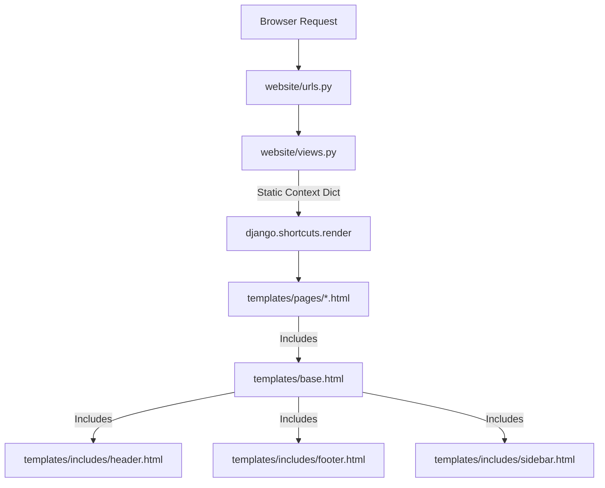
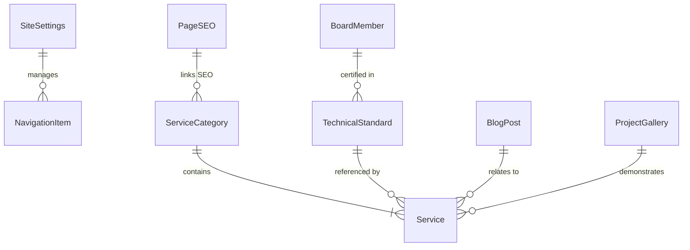

# Dynamic Content Audit

## 1. Executive Summary

This document presents a comprehensive content audit of the **BG Group of Paint & Coatings Consultant** website repository (`bgcoating`). The website has been converted from legacy static files to Django templates (`templates/base.html`, `templates/includes/*`, and `templates/pages/*`), backed by a Django application (`website/`).

Currently, **over 95% of the website content and metadata is hardcoded** directly inside template HTML files and view dictionary contexts (`website/views.py`). No database models currently exist in `website/models.py`.

### Audit Findings & Recommendations:
1. **Zero Existing Database Models**: `website/models.py` is an empty stub.
2. **Hardcoded Context Metadata**: Page titles, meta descriptions, canonical URLs, and active tab flags are passed as static strings in `website/views.py`.
3. **Embedded JSON/Array Data in Templates & Footer JS**:
   - `GAL` JavaScript array in `templates/includes/footer.html` stores 16 gallery items (images, titles, categories, standards, summaries).
   - Filter buttons and blog card collections in `templates/pages/blog.html` store 8 technical blog posts with categories, dates, read times, search terms, and external URLs.
4. **Widespread Content Duplication**:
   - Contact details (`inquiry.bggroup@gmail.com`, `+91-99258-10408`, office address in Surat) are repeated across `templates/includes/header.html`, `templates/includes/footer.html`, `templates/pages/index.html`, `templates/pages/contact.html`, and `templates/pages/about.html`.
   - Technical standards (`ISO 12944`, `NACE`, `AMPP`, `SSPC`, `ASTM`) are repeated in marquee tickers across `templates/pages/about.html` and `templates/pages/blog.html`.
   - Leadership & Board member credentials are split across `templates/pages/about.html` and `templates/pages/board.html`.
5. **Proposed Dynamic Architecture**: We propose 12 targeted Django models (`SiteSettings`, `NavigationItem`, `PageSEO`, `ServiceCategory`, `Service`, `ProjectGallery`, `BlogPost`, `BoardMember`, `ClientTestimonial`, `Industry`, `TechnicalStandard`, `ContactSubmission`) to achieve maximum dynamic flexibility, full SEO control, and complete reusability without introducing unnecessary schema bloat.

*Note: Per requirements, `calculator.html` and legacy root-level PHP/HTML files are excluded from this audit as they are scheduled for deletion.*

---

## 2. Existing Architecture

### File & Directory Structure:
```text
bgcoating/
├── bgcoating_config/        # Project Configuration
│   ├── settings.py
│   ├── urls.py
│   └── wsgi.py
├── website/                 # Primary Django App
│   ├── admin.py             # Empty
│   ├── models.py            # Empty (4 lines)
│   ├── views.py             # Render functions with static context dicts
│   └── urls.py              # Page URL routes
├── templates/               # Django Templates
│   ├── base.html            # Layout shell, head meta, global scripts
│   ├── includes/
│   │   ├── header.html      # Topbar, navbar brand, main menu, drawer
│   │   ├── footer.html      # Footer layout & embedded page initialization JS
│   │   └── sidebar.html     # Interactive "On this site" section rail
│   └── pages/
│       ├── index.html       # Homepage (Hero, Process, Services, CTA, etc.)
│       ├── about.html       # Company overview, Journey, Why BG, Expertise
│       ├── services.html    # Detailed service categories & offerings
│       ├── blog.html       # Knowledge hub, featured article, blog grid
│       ├── gallery.html     # Project gallery grid & before/after comparisons
│       ├── contact.html     # Technical enquiry form, office info, map
│       └── board.html       # Board team, leadership, certifications & awards
└── static/                  # Static Assets
    ├── assets/images/       # 54 image files (logos, visual standards, blogs)
    ├── css/styles.css
    └── js/main.js
```

### Current Data Flow:


---

## 3. Current Dynamic Content

| Content Element | File Location | Dynamic Source | Method | Status |
| :--- | :--- | :--- | :--- | :--- |
| `page_title` | [views.py](file:///c:/Users/DeLL/Downloads/bgcoating/bgcoating/website/views.py) | View Context Dict | `{{ page_title }}` in `base.html` | Partially Dynamic (Hardcoded in Python View) |
| `page_desc` | [views.py](file:///c:/Users/DeLL/Downloads/bgcoating/bgcoating/website/views.py) | View Context Dict | `{{ page_desc }}` in `base.html` | Partially Dynamic (Hardcoded in Python View) |
| `page_canonical` | [views.py](file:///c:/Users/DeLL/Downloads/bgcoating/bgcoating/website/views.py) | View Context Dict | `{{ page_canonical }}` in `base.html` | Partially Dynamic (Hardcoded in Python View) |
| `current_page` | [views.py](file:///c:/Users/DeLL/Downloads/bgcoating/bgcoating/website/views.py) | View Context Dict | Used in navigation `` active tags | Partially Dynamic (Hardcoded in Python View) |
| Active Year | [footer.html](file:///c:/Users/DeLL/Downloads/bgcoating/bgcoating/templates/includes/footer.html#L155) | Client-side JS | `new Date().getFullYear()` | Fully Dynamic (Browser Runtime) |

---

## 4. Hardcoded Content Inventory

Below is the exhaustive inventory of all static content found across the template files:

| Content Element | Current Location | Hardcoded Value / Description | Recommendation |
| :--- | :--- | :--- | :--- |
| Topbar Message | [header.html](file:///c:/Users/DeLL/Downloads/bgcoating/bgcoating/templates/includes/header.html#L5) | "Welcome to BG Group Of Paint &amp; Coatings Consultant" | Move to `SiteSettings.welcome_message` |
| Social Links | [header.html](file:///c:/Users/DeLL/Downloads/bgcoating/bgcoating/templates/includes/header.html#L7-L11), [footer.html](file:///c:/Users/DeLL/Downloads/bgcoating/bgcoating/templates/includes/footer.html#L9-L14), [contact.html](file:///c:/Users/DeLL/Downloads/bgcoating/bgcoating/templates/pages/contact.html#L94-L108) | WhatsApp (`+919925810408`), Facebook, Instagram, YouTube, LinkedIn, Pinterest | Move to `SiteSettings` social URL fields |
| Header Brand / Logo | [header.html](file:///c:/Users/DeLL/Downloads/bgcoating/bgcoating/templates/includes/header.html#L18-L21) | Logo image `logo-2.png`, Brand Name `BG GROUP`, Tagline `Paint & Coatings Consultant` | Move to `SiteSettings` logo & title fields |
| Nav Menu Items | [header.html](file:///c:/Users/DeLL/Downloads/bgcoating/bgcoating/templates/includes/header.html#L24-L31) | Home, About, Board Team, Services, Gallery, Blog, Career (Google Form), Contact | Move to `NavigationItem` model |
| Sidebar Navigation | [sidebar.html](file:///c:/Users/DeLL/Downloads/bgcoating/bgcoating/templates/includes/sidebar.html#L15-L116) | Section anchors for all 7 main pages | Derive dynamically from page section models |
| Footer About Text | [footer.html](file:///c:/Users/DeLL/Downloads/bgcoating/bgcoating/templates/includes/footer.html#L7) | "BG Group of Paint & Coating Consultant is a Surat..." (75 words) | Move to `SiteSettings.footer_description` |
| Office Contact Info | [footer.html](file:///c:/Users/DeLL/Downloads/bgcoating/bgcoating/templates/includes/footer.html#L40-L45), [contact.html](file:///c:/Users/DeLL/Downloads/bgcoating/bgcoating/templates/pages/contact.html#L72-L90) | Working hours (`Mon - Sat · 09:00 am - 06:00 pm`), Address (`E 103, Akash Echo Point, Bhimrad, Surat - 395007`), Emails, Phone | Move to `SiteSettings` global contact fields |
| Footer Blog Highlights | [footer.html](file:///c:/Users/DeLL/Downloads/bgcoating/bgcoating/templates/includes/footer.html#L33-L35) | Hardcoded blog titles & dates from 2023 | Query top 2 `BlogPost` ordered by date |
| Hero Section Content | [index.html](file:///c:/Users/DeLL/Downloads/bgcoating/bgcoating/templates/pages/index.html#L12-L30) | Eyebrow, Display H1, Lead text, Years badge (`22+`), Trust chips | Move to `PageContent` / `SiteSettings` |
| Homepage Services | [index.html](file:///c:/Users/DeLL/Downloads/bgcoating/bgcoating/templates/pages/index.html#L200-L305) | 6 Service cards (Coating Survey, Freelancing, Flooring, Equipment, Process, Specialized) | Query featured `Service` records |
| Gallery Data Array | [footer.html](file:///c:/Users/DeLL/Downloads/bgcoating/bgcoating/templates/includes/footer.html#L314) | `GAL` JS array containing 16 project objects (SSPC-VIS visual standards, refinery surveys, etc.) | Query `ProjectGallery` model |
| Blog Posts | [blog.html](file:///c:/Users/DeLL/Downloads/bgcoating/bgcoating/templates/pages/blog.html#L86-L157) | 8 HTML articles with dates, categories, read times, search terms, and external URLs | Query `BlogPost` model |
| Board Team Members | [board.html](file:///c:/Users/DeLL/Downloads/bgcoating/bgcoating/templates/pages/board.html) | Team member cards, qualifications, certifications, flagship projects, awards | Query `BoardMember` model |
| Industry Tags | [contact.html](file:///c:/Users/DeLL/Downloads/bgcoating/bgcoating/templates/pages/contact.html#L141-L194) | Oil & Gas, Refinery, Marine, Petrochemical, Power, Infrastructure, Heavy Engineering, Renewables | Query `Industry` model |

---

## 5. Global Content Opportunities

The following global elements appear consistently across headers, footers, sidebars, and page sections:

```text
Site Title: BG Group of Paint & Coatings Consultant
Primary Phone: +91-99258-10408
Primary Email: inquiry.bggroup@gmail.com
Support Email: support@bgcoating.com
Office Address: E 103, Akash Echo Point, Bhimrad, Surat – 395007, Gujarat, India
Working Hours: Mon – Sat · 09:00 am – 06:00 pm (Sunday Closed)
Career Form URL: https://forms.gle/v6kCBLKYeeUtMPky8
Copyright Text: © 2026 BG GROUP OF PAINT & COATINGS CONSULTANT · ALL RIGHTS RESERVED · SITE BY TRYON INFOSOFT
```

### Recommendation:
Create a single instance `SiteSettings` Django model (Singleton pattern) to store all global brand details, logos, social media links, working hours, and footer text.

---

## 6. Homepage Opportunities

The homepage (`templates/pages/index.html`) contains several distinct visual blocks:

1. **Hero Banner**:
   - *Eyebrow*: "Industrial Coating Intelligence · Since 2004"
   - *Title*: "Protecting Steel. Engineering Performance."
   - *Lead Paragraph*: "BG Group of Paint & Coating Consultant brings 22+ years..."
   - *Stats Chip*: `22+` Years Hands-On
   - *Trust Chips*: `REFINERY SPECIALISTS`, `OIL & GAS`, `DIGITAL COATING SOLUTIONS`
2. **Services Snapshot Grid**:
   - 6 Cards: Coating Survey, Freelancing Experts, Floor Coating, Refinery Equipment, Process Consultancy, Specialized Applications (TSA/PFP/FRE).
3. **Surface Transformation / Process Flow**:
   - 5 Process Stages: Surface Inspection & Diagnosis → Specification Engineering → Execution Oversight → Testing & Quality Validation → Asset Handover & Digital Record.
4. **Featured Work / Project Highlights**:
   - 4 Featured project cards pulling from the main gallery.
5. **Client Words / Testimonials**:
   - 4 Client testimonial cards (Refinery Maintenance Manager, EPC Project Lead, Asset Integrity Head, QA/QC Inspector).
6. **Latest Insights**:
   - Top 3 blog article previews.

### Model Distribution:
- Hero text & Stats → `SiteSettings` or Page-specific Block
- Services → `Service` model
- Testimonials → `ClientTestimonial` model
- Insights → `BlogPost` model

---

## 7. Product / Insurance Page Audit

*Note: While the prompt mentions insurance page examples for reference schema, BG Coating operates as an Industrial Surface & Protective Coatings Consultancy.*

The equivalent core product/service entities on this website are **Industrial Coating Services**:
- Surface Preparation & Blast Cleaning Assessment (SSPC / ISO 12944 / NACE)
- Coating Inspection & QA/QC Audit
- Refinery Equipment & Tank Lining
- Industrial Floor Coating (Epoxy / Polyurethane)
- Coating Training & Field Certification
- Specialized Applications (Thermal Spray Aluminium - TSA, Passive Fire Protection - PFP, FRE)

### Candidate Model: `Service` / `ServiceCategory`
Each service offering requires:
- Service Name, Slug, Short Excerpt, Full Description
- Standard Reference (e.g., ISO 12944, NACE, AMPP, SSPC)
- Icon / Featured Image
- Benefits List
- Category Relation (`ServiceCategory`)

---

## 8. Insurer Content Opportunities

*(In the context of BG Coating, "Insurers/Partners" corresponds to Third-Party Standards Bodies, Testing Frameworks, and Major Industrial Clients/Third-Party Audit Standards).*

### Entities Identified in Repository:
- **Standards & Certifying Bodies**: ISO 12944, NACE International, AMPP (Association for Materials Protection and Performance), SSPC (Society for Protective Coatings), ASTM International.
- **Visual Reference Standards**: SSPC-VIS 1, SSPC-VIS 2, SSPC-VIS 3, SSPC-VIS 4, SSPC-VIS 5.

### Duplication Analysis:
`DUPLICATED CONTENT → SHOULD BE CENTRALIZED`
The standards list (`ISO 12944`, `NACE`, `AMPP`, `SSPC`, `ASTM`) is duplicated across:
- `templates/pages/about.html` (Marquee ticker lines 34-37)
- `templates/pages/blog.html` (Marquee ticker lines 28-32)
- `templates/includes/footer.html` (JS initialization blocks)

### Recommendation:
Create a `TechnicalStandard` model to manage standards, badges, logos, and descriptions centrally.

---

## 9. Blog / Content Opportunities

The blog page ([templates/pages/blog.html](file:///c:/Users/DeLL/Downloads/bgcoating/bgcoating/templates/pages/blog.html)) contains 8 technical articles:

1. *Uncover The Hurdles Within The Coating Field & Strategic Prioritization...* (27 SEP 2023 · 6 min read · Category: Productivity)
2. *The Unexplored Depths Of Abrasive Blasting Profiles: Ra, Rm And Rz...* (21 SEP 2023 · 8 min read · Category: Surface Preparation)
3. *Expedite Curing Of Inorganic Zinc Silicate Primer And Ensure Validation Through ASTM D 4752...* (19 SEP 2023 · 7 min read · Category: Protective Coatings)
4. *Exploring Coating Adhesion: The Cross-Cut V-Cut Test...* (15 SEP 2023 · 5 min read · Category: Inspection)
5. *Abrasive Blasting Vs. Hydro Blasting: Choosing The Right Method...* (31 AUG 2023 · 7 min read · Category: Surface Preparation)
6. *The Crucial Role Of Air Receiver Tanks In Blasting Operations...* (22 AUG 2023 · 5 min read · Category: Surface Preparation)
7. *Understanding Salt Contamination Testing On Blasted Surfaces...* (22 AUG 2023 · 6 min read · Category: Corrosion)
8. *Unveiling The Brilliance: Enhancing Thermal Spray Aluminum...* (18 AUG 2023 · 6 min read · Category: Protective Coatings)

### Identified Blog Content Fields:
- Title, Slug, Category, Publish Date, Reading Time
- Excerpt, Full Content, Search Keywords (`data-search`)
- Featured Image (`/static/assets/images/...`)
- External Detail Link / Local Detail View URL
- Featured Status (`is_featured` for Editor's Choice card)

---

## 10. FAQ Opportunities

Currently, FAQs are embedded contextually in service descriptions and contact consultation blocks (e.g., questions regarding coating survey turnarounds, NACE certification validity, and site visit scheduling).

### Recommended Candidate Model: `FAQ`
- Question (`CharField`)
- Answer (`TextField`)
- Category / Service relation (`ForeignKey` to `Service`, optional)
- Order (`IntegerField`)
- SEO Structured Data Generation (`JSON-LD` FAQPage schema)

---

## 11. Location SEO Opportunities

### Existing Location References in Codebase:
- **Headquarters / Main Office**: Surat, Gujarat, India (`E 103, Akash Echo Point, Bhimrad, Surat – 395007`).
- **Primary Service Regions Mentioned in Content**: Surat, Hazira Industrial Belt, Jamnagar Refineries, Dahej Petrochemical Complex, Mumbai Marine/Offshore, Gujarat Industrial Development Corporation (GIDC) Parks.

### SEO Opportunity:
Create a `ServiceLocation` / `LocationLandingPage` model for targeted regional SEO:
- *Coating Inspection in Surat & Hazira*
- *NACE Certified Coating Consultant in Jamnagar*
- *Industrial Floor Coating Services in Dahej & Vadodara*

---

## 12. Navigation Opportunities

Inspect [templates/includes/header.html](file:///c:/Users/DeLL/Downloads/bgcoating/bgcoating/templates/includes/header.html) and [templates/includes/sidebar.html](file:///c:/Users/DeLL/Downloads/bgcoating/bgcoating/templates/includes/sidebar.html):

| Navigation Item | Hardcoded URL | Target Page | Recommended Model Field | Reusable? | SEO Impact |
| :--- | :--- | :--- | :--- | :--- | :--- |
| Home | `` | Homepage | `NavigationItem.url` | Yes | High |
| About Us | `` | About Page | `NavigationItem.url` | Yes | High |
| Board Team | `` | Technical Board | `NavigationItem.url` | Yes | Medium |
| Services | `` | Services Hub | `NavigationItem.url` | Yes | High |
| Gallery | `` | Project Portfolio | `NavigationItem.url` | Yes | Medium |
| Blog & Insights | `` | Blog Hub | `NavigationItem.url` | Yes | High |
| Career | `https://forms.gle/...` | Google Form (External) | `NavigationItem.url` | Yes | Low |
| Contact Us | `` | Contact Page | `NavigationItem.url` | Yes | High |

---

## 13. Footer Opportunities

Inspect [templates/includes/footer.html](file:///c:/Users/DeLL/Downloads/bgcoating/bgcoating/templates/includes/footer.html):
- **Brand Logo & Description**: Static text about Surat-based consultancy.
- **Quick Links**: 6 hardcoded navigation items.
- **Latest Blog Widgets**: 2 hardcoded blog headlines with dates (`27-SEP-2023`, `21-SEP-2023`).
- **Contact Details**: Working hours, office address, phone, emails.
- **Newsletter Form**: Static HTML form handled by client JS.
- **Copyright Line**: Year generated by JS (`#year`), agency link (`TRYON INFOSOFT`).

---

## 14. CTA Opportunities

Repeated Call-to-Action patterns across templates:

| CTA Label | Target Link / Action | Position / Page | Type | Recommendation |
| :--- | :--- | :--- | :--- | :--- |
| "Get a Consultation →" | `` | Header, Mobile Drawer | Primary Button | Centralize in `SiteSettings` |
| "Explore BG Coating OS™ →" | `` | Homepage Hero | Primary Button | Centralize in `SiteSettings` |
| "Talk to a Consultant" | `https://wa.me/919925810408...` | Hero / About Hero | WhatsApp Direct | Centralize in `SiteSettings` |
| "Request A Technical Consultation" | `#enquiry` | Footer CTA Band / Contact | Primary Button | Centralize in `SiteSettings` |
| "Read Full Article →" | `` | Blog Featured | Secondary Button | Post-specific |

---

## 15. Media Opportunities

Exhaustive audit of images referenced in templates from `/static/assets/images/`:

| Image File Path | Template Location | Purpose / Description | Alt Text | Managed via Model? |
| :--- | :--- | :--- | :--- | :--- |
| `logo-2.png` | `header.html`, `base.html` | Primary Brand Logo & Favicon | "BG Group of Paint & Coatings Consultant logo" | `SiteSettings.logo` |
| `footer-logo.png` | `footer.html` | Footer Logo | "BG Group of Paint & Coatings Consultant" | `SiteSettings.footer_logo` |
| `02_R1__JPG___SSPC_VIS_1-transformed.jpeg` | `gallery.html`, `footer.html` | SSPC-VIS 1 Visual Standard Comparator | "SSPC-VIS 1 Visual Standard" | `ProjectGallery.image` |
| `03__JPG___SSPC_VIS_2-transformed.jpeg` | `gallery.html`, `footer.html` | SSPC-VIS 2 Visual Standard | "SSPC-VIS 2 Visual Standard" | `ProjectGallery.image` |
| `SSPC_VIS_3.jpg` | `gallery.html`, `footer.html` | SSPC-VIS 3 Hand Tool Prep | "SSPC-VIS 3 Visual Standard" | `ProjectGallery.image` |
| `SSPC_vis_4.jpg` | `gallery.html`, `footer.html` | SSPC-VIS 4 Waterjetting Standard | "SSPC-VIS 4 Visual Standard" | `ProjectGallery.image` |
| `SSPC_VIS_5.jpg` | `gallery.html`, `footer.html` | SSPC-VIS 5 Wet Blasting Standard | "SSPC-VIS 5 Visual Standard" | `ProjectGallery.image` |
| `01__Coating_Survey_and_Corrosion_Assessment-transformed.png` | `gallery.html` | Refinery Coating Survey | "Coating Survey & Corrosion Assessment" | `ProjectGallery.image` |
| `R2_1_Refinery_Vessel.jpg` | `gallery.html` | Refinery Vessel Coating | "Refinery Vessel Coating & Cleaning" | `ProjectGallery.image` |
| `R2___1_Floor_Coating.jpg` | `gallery.html` | Industrial Epoxy Flooring | "Industrial Floor Coating" | `ProjectGallery.image` |
| `Main_Thumbnail_3.jpg` | `blog.html` | Blog 1 Thumbnail | "Coating field challenges and strategic prioritization" | `BlogPost.featured_image` |
| `Front_Page_Microns.jpg` | `blog.html` | Blog 2 Thumbnail | "Abrasive blasting profiles Ra Rm Rz explained" | `BlogPost.featured_image` |
| `Front_Page.jpg` | `blog.html` | Blog 3 Thumbnail | "Inorganic zinc silicate primer curing" | `BlogPost.featured_image` |
| `Prakash_Ramavat.jpg` | `board.html` | Founder / Principal Consultant | "Prakash Ramavat - NACE Level 3 Inspector" | `BoardMember.photo` |

---

## 16. SEO Opportunities

Current SEO values in [website/views.py](file:///c:/Users/DeLL/Downloads/bgcoating/bgcoating/website/views.py):

| Page Route | Current `page_title` | Current `page_desc` | Current `page_canonical` | Scope | SEO Value |
| :--- | :--- | :--- | :--- | :--- | :--- |
| `home` (`/`) | BG GROUP Of Paint & Coatings Consultant \| Industrial Coating Experts | Protective coatings, surface preparation, corrosion assessment... | `https://bgcoating.com/` | page | High |
| `about` (`/about/`) | About BG Group \| Industrial Coating & Corrosion Experts | Discover BG Group — 22+ years of surface engineering... | `https://bgcoating.com/about.php` | page | High |
| `services` (`/services/`) | Services \| BG Group Of Paint & Coatings Consultant | Comprehensive coating consultancy, surface preparation... | `https://bgcoating.com/services.php` | page | High |
| `blog` (`/blog/`) | Technical Insights & Blog \| BG Group | Read technical articles, surface preparation guides... | `https://bgcoating.com/blog.php` | page | High |
| `gallery` (`/gallery/`) | Project Gallery \| BG Group | View our past surface preparation, industrial painting... | `https://bgcoating.com/gallery.php` | page | Medium |
| `contact` (`/contact/`) | Contact Us \| BG Group Of Paint & Coatings Consultant | Get in touch with NACE/AMPP certified experts... | `https://bgcoating.com/contact.php` | page | High |
| `board` (`/board/`) | Technical Board & Leadership Team \| BG Group | Meet the leadership and technical board... | `https://bgcoating.com/board.php` | page | Medium |

### Missing SEO Elements:
1. Open Graph (`og:title`, `og:description`, `og:image`, `og:url`) meta tags.
2. Twitter Card meta tags.
3. Dynamic JSON-LD Structured Data (`Organization`, `LocalBusiness`, `Article`, `FAQPage`, `BreadcrumbList`).
4. Custom Robots directive (`index, follow` is currently hardcoded in `base.html`).

---

## 17. Repeated Content / Duplication Audit

`DUPLICATED CONTENT → SHOULD BE CENTRALIZED`

1. **Company Phone & Email**:
   - Header topbar (`header.html`)
   - Footer contact column (`footer.html`)
   - Contact page sidebar & CTA band (`contact.html`)
   - About page CTA (`about.html`)
   *Solution*: Manage centrally via `SiteSettings`.

2. **Standards List (ISO 12944, NACE, AMPP, SSPC, ASTM)**:
   - Marquee on About page (`about.html`)
   - Marquee on Blog page (`blog.html`)
   - Footer initialization scripts (`footer.html`)
   *Solution*: Query from `TechnicalStandard` model.

3. **Gallery Data Objects**:
   - `GAL` JS array in `footer.html`
   - Static HTML cards in `gallery.html`
   *Solution*: Single source of truth in `ProjectGallery` model.

4. **Board / Leadership Credentials**:
   - Summary card on About page (`about.html#leadership`)
   - Full profiles on Board page (`board.html`)
   *Solution*: Single source of truth in `BoardMember` model.

---

## 18. Existing Model Reuse Analysis

Inspection of [website/models.py](file:///c:/Users/DeLL/Downloads/bgcoating/bgcoating/website/models.py):
- The file contains 4 lines of boilerplate (`from django.db import models`).
- There are **no existing Django models** in this project.
- No risk of duplicating existing models. All proposed models are fresh additions to `website/models.py`.

---

## 19. Proposed Django Models

### Model 1: `SiteSettings`
- **Purpose**: Stores global website settings, brand information, contact details, and social media URLs.
- **Scope**: `global`
- **Priority**: `P0`
- **Used by**: `templates/base.html`, `templates/includes/header.html`, `templates/includes/footer.html`, `templates/pages/contact.html`
- **SEO Relevance**: High
- **Reusable**: Yes

### Model 2: `PageSEO`
- **Purpose**: Provides configurable meta titles, descriptions, Open Graph data, and canonical URLs for every static route or page.
- **Scope**: `page`
- **Priority**: `P0`
- **Used by**: `templates/base.html`
- **SEO Relevance**: High
- **Reusable**: Yes

### Model 3: `NavigationItem`
- **Purpose**: Stores main menu links, header navigation, drawer items, and footer quick links.
- **Scope**: `global`
- **Priority**: `P0`
- **Used by**: `templates/includes/header.html`, `templates/includes/footer.html`
- **SEO Relevance**: Medium
- **Reusable**: Yes

### Model 4: `ServiceCategory`
- **Purpose**: Groups individual coating services into categories (Surface Prep, Inspection, Consultancy, Digital, Training).
- **Scope**: `global/product`
- **Priority**: `P0`
- **Used by**: `templates/pages/services.html`, `templates/pages/index.html`, `templates/includes/sidebar.html`
- **SEO Relevance**: High
- **Reusable**: Yes

### Model 5: `Service`
- **Purpose**: Stores detailed industrial coating service descriptions, features, standards, and icons.
- **Scope**: `product`
- **Priority**: `P0`
- **Used by**: `templates/pages/services.html`, `templates/pages/index.html`
- **SEO Relevance**: High
- **Reusable**: Yes

### Model 6: `ProjectGallery`
- **Purpose**: Stores past project portfolio items, visual standards (SSPC-VIS), and before/after comparisons.
- **Scope**: `global`
- **Priority**: `P1`
- **Used by**: `templates/pages/gallery.html`, `templates/includes/footer.html` (JS payload)
- **SEO Relevance**: Medium
- **Reusable**: Yes

### Model 7: `BlogPost`
- **Purpose**: Stores technical articles, guides, surface preparation benchmarks, and insights.
- **Scope**: `blog`
- **Priority**: `P0`
- **Used by**: `templates/pages/blog.html`, `templates/includes/footer.html`, `templates/pages/index.html`
- **SEO Relevance**: High
- **Reusable**: Yes

### Model 8: `BoardMember`
- **Purpose**: Stores leadership team profiles, NACE/AMPP certifications, career journey, and awards.
- **Scope**: `content`
- **Priority**: `P1`
- **Used by**: `templates/pages/board.html`, `templates/pages/about.html`
- **SEO Relevance**: Medium
- **Reusable**: Yes

### Model 9: `ClientTestimonial`
- **Purpose**: Stores client reviews, refinery endorsements, and trust feedback.
- **Scope**: `global`
- **Priority**: `P1`
- **Used by**: `templates/pages/index.html`
- **SEO Relevance**: Medium
- **Reusable**: Yes

### Model 10: `Industry`
- **Purpose**: Stores target industry sectors served (Oil & Gas, Refinery, Marine, Power, Petrochemical).
- **Scope**: `global`
- **Priority**: `P2`
- **Used by**: `templates/pages/about.html`, `templates/pages/contact.html`
- **SEO Relevance**: Medium
- **Reusable**: Yes

### Model 11: `TechnicalStandard`
- **Purpose**: Manages standards and frameworks (ISO 12944, NACE, AMPP, SSPC, ASTM).
- **Scope**: `global`
- **Priority**: `P1`
- **Used by**: `templates/pages/about.html`, `templates/pages/blog.html`, `templates/pages/services.html`
- **SEO Relevance**: High
- **Reusable**: Yes

### Model 12: `ContactSubmission`
- **Purpose**: Stores user contact and technical consultation form submissions.
- **Scope**: `global`
- **Priority**: `P0`
- **Used by**: `templates/pages/contact.html`
- **SEO Relevance**: Low
- **Reusable**: No

---

## 20. Proposed Model JSON Schemas

```json
[
  {
    "model": "SiteSettings",
    "purpose": "Stores global site settings, contact details, branding, and social links",
    "scope": "global",
    "priority": "P0",
    "fields": {
      "site_name": { "type": "CharField", "required": true, "example": "BG Group Of Paint & Coatings Consultant" },
      "tagline": { "type": "CharField", "required": true, "example": "Industrial Coating Intelligence · Since 2004" },
      "logo": { "type": "ImageField", "required": true, "example": "assets/images/logo-2.png" },
      "footer_logo": { "type": "ImageField", "required": true, "example": "assets/images/footer-logo.png" },
      "phone_number": { "type": "CharField", "required": true, "example": "+91-99258-10408" },
      "whatsapp_number": { "type": "CharField", "required": true, "example": "919925810408" },
      "primary_email": { "type": "EmailField", "required": true, "example": "inquiry.bggroup@gmail.com" },
      "support_email": { "type": "EmailField", "required": false, "example": "support@bgcoating.com" },
      "office_address": { "type": "TextField", "required": true, "example": "E 103, Akash Echo Point, Bhimrad, Surat – 395007, Gujarat, India" },
      "working_hours": { "type": "CharField", "required": true, "example": "Mon – Sat · 09:00 am – 06:00 pm" },
      "facebook_url": { "type": "URLField", "required": false, "example": "https://www.facebook.com/bggroupcoatingsolutions" },
      "instagram_url": { "type": "URLField", "required": false, "example": "https://www.instagram.com/bggroupcoatingsolutions/" },
      "youtube_url": { "type": "URLField", "required": false, "example": "https://www.youtube.com/@bggroupcoatingconsultant" },
      "linkedin_url": { "type": "URLField", "required": false, "example": "https://www.linkedin.com/company/bggroupofpaintandcoatingconsultant/" },
      "footer_description": { "type": "TextField", "required": true, "example": "BG Group of Paint & Coating Consultant is a Surat, Gujarat based..." }
    },
    "relationships": {},
    "seo_value": "high"
  },
  {
    "model": "PageSEO",
    "purpose": "Stores SEO metadata per page route",
    "scope": "page",
    "priority": "P0",
    "fields": {
      "page_identifier": { "type": "CharField", "required": true, "unique": true, "example": "home" },
      "meta_title": { "type": "CharField", "required": true, "example": "BG GROUP Of Paint & Coatings Consultant | Industrial Coating Experts" },
      "meta_description": { "type": "TextField", "required": true, "example": "Protective coatings, surface preparation, corrosion assessment & NACE/AMPP-aligned inspection..." },
      "canonical_url": { "type": "URLField", "required": true, "example": "https://bgcoating.com/" },
      "og_image": { "type": "ImageField", "required": false, "example": "assets/images/og-home.jpg" },
      "robots": { "type": "CharField", "required": true, "example": "index, follow" }
    },
    "relationships": {},
    "seo_value": "high"
  },
  {
    "model": "ServiceCategory",
    "purpose": "Groups coating services into logical departments",
    "scope": "product",
    "priority": "P0",
    "fields": {
      "name": { "type": "CharField", "required": true, "example": "Surface & Coatings" },
      "slug": { "type": "SlugField", "required": true, "unique": true, "example": "surface-coatings" },
      "description": { "type": "TextField", "required": false, "example": "Surface preparation and protective coating solutions." },
      "order": { "type": "IntegerField", "required": true, "example": 1 }
    },
    "relationships": {
      "services": "HasMany -> Service"
    },
    "seo_value": "high"
  },
  {
    "model": "Service",
    "purpose": "Stores specific technical service offerings",
    "scope": "product",
    "priority": "P0",
    "fields": {
      "title": { "type": "CharField", "required": true, "example": "Coating Survey & Corrosion Assessment" },
      "slug": { "type": "SlugField", "required": true, "unique": true, "example": "coating-survey-corrosion-assessment" },
      "category": { "type": "ForeignKey", "required": true, "example": "Surface & Coatings" },
      "excerpt": { "type": "TextField", "required": true, "example": "Structured corrosion assessment turning surface observations into maintenance intelligence." },
      "description": { "type": "TextField", "required": true, "example": "Detailed technical description of the survey workflow..." },
      "standard_code": { "type": "CharField", "required": false, "example": "ISO 12944 / NACE" },
      "icon_svg": { "type": "TextField", "required": false, "example": "<svg>...</svg>" },
      "is_featured": { "type": "BooleanField", "required": true, "example": true }
    },
    "relationships": {
      "category": "ForeignKey -> ServiceCategory"
    },
    "seo_value": "high"
  },
  {
    "model": "BlogPost",
    "purpose": "Stores technical insights, guides, and articles",
    "scope": "blog",
    "priority": "P0",
    "fields": {
      "title": { "type": "CharField", "required": true, "example": "The Unexplored Depths Of Abrasive Blasting Profiles: Ra, Rm And Rz" },
      "slug": { "type": "SlugField", "required": true, "unique": true, "example": "abrasive-blasting-profiles-ra-rm-rz" },
      "category_name": { "type": "CharField", "required": true, "example": "Surface Preparation" },
      "publish_date": { "type": "DateField", "required": true, "example": "2023-09-21" },
      "read_time_minutes": { "type": "IntegerField", "required": true, "example": 8 },
      "excerpt": { "type": "TextField", "required": true, "example": "Surface profile is the foundation every coating depends on..." },
      "content": { "type": "TextField", "required": true, "example": "Full article HTML or Markdown..." },
      "featured_image": { "type": "ImageField", "required": true, "example": "assets/images/Front_Page_Microns.jpg" },
      "search_keywords": { "type": "TextField", "required": false, "example": "abrasive blasting roughness anchor profile micron" },
      "is_featured": { "type": "BooleanField", "required": true, "example": true }
    },
    "relationships": {},
    "seo_value": "high"
  },
  {
    "model": "ProjectGallery",
    "purpose": "Stores project portfolio images and visual standards",
    "scope": "global",
    "priority": "P1",
    "fields": {
      "title": { "type": "CharField", "required": true, "example": "SSPC-VIS 1 Visual Standard" },
      "client_category": { "type": "CharField", "required": true, "example": "Inspection & QA/QC" },
      "location_name": { "type": "CharField", "required": true, "example": "Surface Prep Reference" },
      "service_type": { "type": "CharField", "required": true, "example": "Blast Cleaning Assessment" },
      "summary": { "type": "TextField", "required": true, "example": "Visual comparator for abrasive blast-cleaned steel..." },
      "standard": { "type": "CharField", "required": true, "example": "SSPC-VIS 1" },
      "image": { "type": "ImageField", "required": true, "example": "assets/images/02_R1__JPG___SSPC_VIS_1-transformed.jpeg" },
      "filter_tag": { "type": "CharField", "required": true, "example": "inspection" }
    },
    "relationships": {},
    "seo_value": "medium"
  },
  {
    "model": "BoardMember",
    "purpose": "Stores leadership team credentials and board profiles",
    "scope": "content",
    "priority": "P1",
    "fields": {
      "name": { "type": "CharField", "required": true, "example": "Prakash Ramavat" },
      "role": { "type": "CharField", "required": true, "example": "Principal Coating Consultant & Technical Director" },
      "certification": { "type": "CharField", "required": true, "example": "NACE / AMPP Certified Level 3" },
      "bio": { "type": "TextField", "required": true, "example": "22+ years of hands-on expertise in refinery corrosion..." },
      "photo": { "type": "ImageField", "required": true, "example": "assets/images/Prakash_Ramavat.jpg" },
      "display_order": { "type": "IntegerField", "required": true, "example": 1 }
    },
    "relationships": {},
    "seo_value": "medium"
  },
  {
    "model": "ContactSubmission",
    "purpose": "Stores client consultation form enquiries",
    "scope": "global",
    "priority": "P0",
    "fields": {
      "full_name": { "type": "CharField", "required": true, "example": "Rajesh Patel" },
      "company": { "type": "CharField", "required": false, "example": "Reliance Industries" },
      "email": { "type": "EmailField", "required": true, "example": "rajesh.patel@ril.com" },
      "phone": { "type": "CharField", "required": true, "example": "+91-9876543210" },
      "service_of_interest": { "type": "CharField", "required": true, "example": "Refinery Equipment Coating" },
      "message": { "type": "TextField", "required": true, "example": "Need urgent coating inspection for turnaround..." },
      "submitted_at": { "type": "DateTimeField", "required": true, "example": "2026-08-13T16:50:00Z" }
    },
    "relationships": {},
    "seo_value": "none"
  }
]
```

---

## 21. Model Relationships



---

## 22. URL / SEO Architecture

Recommended clean URL structure to replace legacy `.php` and static routes:

```text
/                              -> Homepage
/about/                        -> Company Overview
/services/                     -> Services Hub
/services/<category-slug>/     -> Services by Category
/services/<service-slug>/      -> Service Detail Page (High SEO)
/blog/                         -> Knowledge Hub
/blog/<article-slug>/          -> Blog Article Detail Page (High SEO)
/gallery/                      -> Project Portfolio & Visual Standards
/board/                        -> Technical Board & Leadership
/contact/                      -> Consultation Request
/sitemap.xml                   -> Dynamic XML Sitemap
/robots.txt                    -> Dynamic Robots File
```

---

## 23. Sitemap Opportunities

A dynamic XML sitemap generator (`django.contrib.sitemaps`) should automatically crawl:
1. Static Page Views (`home`, `about`, `services`, `gallery`, `blog`, `board`, `contact`).
2. `Service` Detail Pages.
3. `BlogPost` Detail Pages.
4. `ProjectGallery` Detail Items.

**Sitemap Priorities**:
- Homepage: `1.0` (Daily)
- Services & Detail Pages: `0.9` (Weekly)
- Blog Articles: `0.8` (Weekly)
- About / Board / Contact: `0.6` (Monthly)

---

## 24. Structured Data Opportunities

Implement `JSON-LD` structured data injected dynamically into `templates/base.html`:

1. **Organization / LocalBusiness**:
   - Injected on all pages.
   - Includes company name, Surat office coordinates (`21.1425, 72.7845`), phone, email, opening hours, social profiles.
2. **Article / NewsArticle**:
   - Injected on `BlogPost` pages.
   - Includes headline, publish date, author, featured image, publisher logo.
3. **FAQPage**:
   - Injected on pages containing FAQs.
   - Boosts Google Rich Results appearance.
4. **BreadcrumbList**:
   - Injected on inner pages (`HOME › SERVICES › COATING SURVEY`).

---

## 25. Priority Matrix

| Feature / Model | Priority | Complexity | SEO Impact | Business Value |
| :--- | :--- | :--- | :--- | :--- |
| `PageSEO` (Title, Meta, Canonical) | **P0** | Low | **High** | Critical |
| `SiteSettings` (Contact, Logos, Social) | **P0** | Low | Medium | High |
| `BlogPost` (Articles & Insights) | **P0** | Medium | **High** | High |
| `ServiceCategory` & `Service` | **P0** | Medium | **High** | Critical |
| `ContactSubmission` (Enquiries) | **P0** | Low | None | Critical |
| `ProjectGallery` (Portfolio & Visual Standards)| **P1** | Medium | Medium | High |
| `BoardMember` (Leadership Credentials) | **P1** | Low | Medium | Medium |
| `TechnicalStandard` (NACE/ISO/AMPP Badges) | **P1** | Low | **High** | Medium |
| `ClientTestimonial` (Trust Badges) | **P2** | Low | Low | Medium |
| `Industry` (Sectors Served) | **P2** | Low | Medium | Low |

---

## 26. Recommended Implementation Order

To ensure a smooth transition without breaking the frontend:

1. **Phase 1: Global Settings & SEO Foundations (P0)**
   - Implement `SiteSettings` and `PageSEO` models.
   - Connect `base.html`, `header.html`, and `footer.html` to context processors.

2. **Phase 2: Core Business Content (P0)**
   - Implement `ServiceCategory` and `Service` models.
   - Update `templates/pages/services.html` to loop over querysets.
   - Wire `ContactSubmission` form in `website/views.py`.

3. **Phase 3: Content Marketing & Insights (P0)**
   - Implement `BlogPost` model.
   - Replace hardcoded blog grid in `templates/pages/blog.html`.

4. **Phase 4: Trust & Verification Assets (P1 - P2)**
   - Implement `ProjectGallery`, `BoardMember`, `TechnicalStandard`, and `ClientTestimonial` models.
   - Replace JavaScript array payload (`GAL`) in `footer.html` with dynamic JSON serializations.

---

## 27. Content That Should Remain Static

The following items should **NOT** be moved to the database and should remain hardcoded in HTML/CSS/JS:

1. **Layout Grid & Layout Shells**:
   - `templates/base.html` structure, CSS grid classes (`wrap`, `grid-bg`, `hex-bg`).
2. **Interactive UI Components**:
   - SVG visual gauge animations, before/after slider logic (`#baSlider`), canvas background particle scripts (`.fx-canvas`).
3. **Pure Visual Assets & Icons**:
   - SVG icons, directional arrows (`<span class="arr">→</span>`), close/burger icons.
4. **Form Field Structural Labels**:
   - Fixed field names like "Full Name *", "Email *", "Project Details / Message *".
5. **Fixed Design Typography & CSS Variables**:
   - Font choices (`IBM Plex Mono`, `IBM Plex Sans`, `Sora`), color palette definitions (`--accent-2`, `--txt-hi`).

---

## 28. Risks / Considerations

1. **SPA Interactivity & JS State Handoff**:
   - The site uses an inline JavaScript single-page navigation layer (`window.__init_blog`, `window.__init_gallery`, `GAL` array).
   - *Mitigation*: Ensure dynamic database queries serialize JSON directly into template scripts where needed (e.g. `{{ gallery_json|safe }}`).
2. **Hardcoded Internal Anchors**:
   - Navigation links rely on hash anchors (`#sec-services`, `#who-we-are`, `#cnt-info`).
   - *Mitigation*: Maintain anchor fields in `NavigationItem` and section models.
3. **SEO Canonical & Redirect Risks**:
   - Older URLs targeted `.php` endpoints (`about.php`, `services.php`, `contact.php`).
   - *Mitigation*: Ensure Django `urls.py` maintains proper 301 redirects for legacy `.php` routes.
