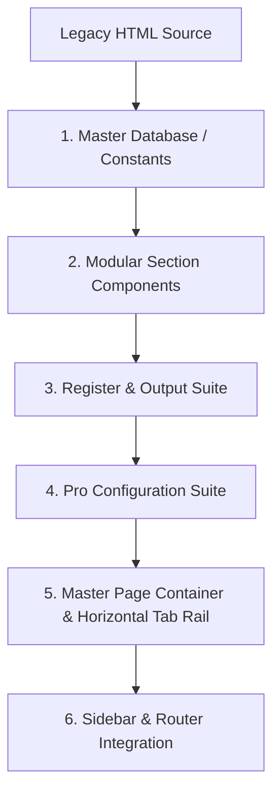

# BG CoatingOS™ — Module Replication & Migration Playbook

This playbook documents the standardized, step-by-step methodology used to convert legacy standalone single-file HTML coating calculators into modular, reactive, MNC-grade React SPA suites (as implemented for **01. Coating Calculator** and **02. Specification Reading**).

Use this playbook as the blueprint for migrating all subsequent modules (e.g., *03. Cost Estimation, 04. QA/QC Inspection, 05. Blaster & Painter Qualification, 06. Coating Procedures, etc.*).

---

## 1. Golden Architecture Pattern

Every major module follows this 6-tier architecture:



---

## 2. Step-by-Step Implementation Workflow

### Step 1: Source Analysis & Data Extraction
1. **Identify Source Reference**: Inspect `backend/static/calculator/<uuid>.html`.
2. **Extract Engineering Rules**:
   - Math formulas, unit conversions (Metric/Imperial).
   - Industry standards (ISO 12944, ISO 8501/2, SSPC-PA 2, NORSOK M-501, NACE).
   - Product / Generic database lookups (AkzoNobel, Jotun, PPG, Carboline, Hempel, Sigma).
3. **Establish Clean Defaults Standard**:
   - Initial input states start empty (`''` or `[]`).
   - Clear explanatory placeholders (`e.g. 500`, `e.g. Sa 2½ (ISO 8501-1)`).
   - Dual-action bottom bar: **Primary Action Button** (`bg-gradient-to-r from-[#F7941D] to-[#A50021]`) + **Secondary Reset Button** (`bg-white border-slate-200 hover:bg-rose-50 text-rose-600`).

---

### Step 2: Master Engineering Database (`src/data/<module>Database.js`)
Create a dedicated database file containing:
- Standard dropdown options (`SELECT_OPTIONS`).
- Reference standards, test methods, tolerances.
- 1-click industry preset configurations.
- Generic to proprietary product mappings.

---

### Step 3: Modular Sub-Tool Components (`src/tools/<module>/`)
Split the feature set into focused, reusable sub-components:
- **`SpecHub.jsx` / Overview Hub**: Visual dashboard with interactive cards for all sections + 1-click standard presets.
- **Section Forms (`SectionA.jsx`, `SectionB.jsx`, etc.)**:
  - Receive state and setter props.
  - Defensive fallback on all array/object props (`fRows = []`, `data = {}`).
  - Optional chaining on all nested reads (`data?.field`).
  - Next/Previous section stepper buttons.

---

### Step 4: Register & Output Suite (Standard Executive Suite)
Every module must include this turnkey output bundle:

1. **`ReportRegister.jsx` (`/<module>/register`)**:
   - **Stats KPIs**: Total Records, Drafts, Approved, In Review.
   - **Local Storage Database**: Keyed under `bg_os_<module>_reports_register`.
   - **Actions**: `Save Workspace to Register`, `Load/Edit into Workspace`, `Preview`, `Duplicate`, `Delete`, `Export CSV / Excel`.
   - Live Search & Status Filter pills.

2. **`PreviewModal.jsx` (`/<module>/preview`)**:
   - Full read-only A4 dossier modal overlay.
   - Interactive zoom controls (`Zoom In`, `Zoom Out`, `100%`, `Reset`).
   - Dynamic custom corporate branding header + Live diagonal watermark.
   - Direct `Print Official PDF` trigger.

3. **`ReportView.jsx` (`/<module>/report`)**:
   - Print-optimized CSS (`@media print`) matching ISO / MNC audit standards.
   - Engineering sign-off blocks (Prepared By, Reviewed By, QA Inspector).
   - Direct JSON draft export & clipboard copy actions.

---

### Step 5: Pro Configuration Suite
1. **`CompanyDetailsModal.jsx` (`/<module>/company-details`)**:
   - Manages Corporate Profile: Company Name, Tagline, Phone, Email, Website, Address, and Custom Logo upload (Base64 file reader).
   - Persists to `bg_company_profile` in `localStorage`.
   - Overrides default BG Group branding in all preview and print templates.
   - "Reset to BG Default" action.

2. **`WatermarkControl.jsx` (`/<module>/watermark`)**:
   - Controls: Master Toggle (ON/OFF), Opacity Slider (3%–30%), Angle Slider (-60° to 0°), Custom Text.
   - Persists to `bg_watermark_settings`.
   - Live interactive A4 sheet preview canvas displaying tiled diagonal watermark.

---

### Step 6: Master Page Container (`src/pages/<Module>Page.jsx`)
- Controls master state object and localStorage autosave draft.
- Top Action Bar with Quick Buttons:
  - `Company Details (Pro)`
  - `Preview`
  - `Save Draft`
  - `Reset All`
- Horizontal Scrollable Sub-Navigation Rail with active gradient pill.
- **Route Switch Block with Fallback**:
  - Always handle `company_details` and `preview` explicitly.
  - Fallback to `<OverviewHub />` if `currentSection` is unrecognized so the page **never renders blank**.

---

### Step 7: Routing & Sidebar Integration
1. **`src/utils/router.js`**:
   - Register all sub-routes with dedicated module prefix:
     `'subtool_id': '/<module>/<subtool-slug>'`
   - Update `parseCurrentUrl()` and `getUrlFor()`.
2. **`src/components/Sidebar.jsx`**:
   - Organize accordion sub-items into 3 distinct categories:
     1. **Project / Form Sections**
     2. **Register & Output** (*Report Register, Preview, Print Dossier [Pro]*)
     3. **Configuration** (*Company Details [Pro], Watermark [Pro]*)
   - Use `onNavigate(page, subTool)` for atomic routing updates.
3. **`src/App.jsx`**:
   - Pass `onNavigate={navigate}` to `<Sidebar />`.

---

## 3. Pre-Flight Verification Checklist

Before considering any module complete, run this 5-point audit:

- [ ] **1. Clean Defaults**: All text inputs and number inputs start empty with clear `e.g. ...` placeholders.
- [ ] **2. Defensive React Safety**: All `.map()`, `.reduce()`, `.filter()` calls use `(arr || [])` with optional chaining (`item?.prop`).
- [ ] **3. URL Prefix Integrity**: Every sub-tool maintains the `/<module>/...` prefix (no un-namespaced routes).
- [ ] **4. Build Validation**: `npm run build` exits with code 0 and 0 compiler warnings.
- [ ] **5. Endpoint Health Check**: All sub-routes return HTTP 200 OK via fetch/test script.

---

## 4. Quick Module Blueprint Template

```javascript
// Reference Sub-Route Mapping Table
export const MODULE_ROUTES = {
  hub: '/<module>',
  section_1: '/<module>/section-1',
  section_2: '/<module>/section-2',
  register: '/<module>/register',
  preview: '/<module>/preview',
  report: '/<module>/report',
  watermark: '/<module>/watermark',
  company_details: '/<module>/company-details'
};
```
