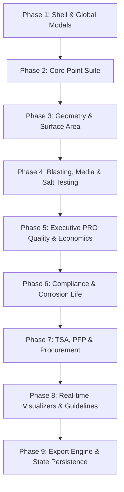

# BG CoatingOS™ — React 1:1 Implementation Roadmap & Engineering Specification

> **Document Version**: 1.0  
> **Source Reference**: `Reference/02. R0_BG CoatingOS™ _ Digital Workspace for Coating Professionals.html`  
> **Target React App**: `calculator-react/`  
> **Target Page Component**: `calculator-react/src/pages/CoatingCalculatorPage.jsx` & Sub-modules

---

## 1. Executive Summary & Architectural Overview

The reference file **`02. R0_BG CoatingOS™ _ Digital Workspace for Coating Professionals.html`** is an enterprise-grade Single-Page Application (SPA) designed for coating inspectors, QA/QC engineers, corrosion consultants, EPC contractors, and asset owners.

### 1.1 Core Platform Architecture
```
┌────────────────────────────────────────────────────────────────────────────────────────┐
│                                   BG CoatingOS™ Shell                                  │
├──────────────────────┬─────────────────────────────────────────────────────────────────┤
│                      │ Top Header Bar:                                                 │
│                      │ [☰ Toggle] [Home › Coating Calculator › Category › Tool] [Zoom] │
│                      │                               [Help ?] [User Profile Dropdown]  │
│  Charcoal Sidebar    ├─────────────────────────────────────────────────────────────────┤
│  Navigation Rail:    │ Workspace Canvas / Active Module:                               │
│  • Brand Identity    │                                                                 │
│  • Dashboard         │  • Dashboard Hub / KPI Metrics / Module Cards                   │
│  • Module 01 (Calc)  │  • Coating Calculator Workspace (36+ Active Tools)             │
│  • Module 02 (Specs) │  • Coating Specification Reading Engine                         │
│  • Knowledge Base    │  • Knowledge Base Standards & Guidelines                        │
│  • Support           │  • Support & Direct Consultation Hotline                        │
│  • Profile/Settings  │  • Profile & Preferences (Metric/Imperial, Currency)            │
│  • Upgrade / Plans   │                                                                 │
│  • User Status Pill  │                                                                 │
└──────────────────────┴─────────────────────────────────────────────────────────────────┘
```

### 1.2 Design System Tokens & Enterprise Palette
| Token Variable | Hex / Value | Description | Usage |
| :--- | :--- | :--- | :--- |
| `--brand-orange` / `--o2` | `#F7941D` | Primary BG Orange | Active borders, primary buttons, accents, sliders |
| `--brand-crimson` / `--o1` | `#A41E22` | Deep BG Red / Crimson | Brand gradients, warnings, high-priority badges |
| `--brand-gold` | `#FFB347` | Golden Orange | Gradients, hover accents, highlight pills |
| `--graphite` / `--charcoal` | `#2B2B2B` | Dark Graphite | Primary text, print buttons, dark cards |
| `--sb-bg` | `#2B303A` to `#22262E` | Charcoal Blue Gradient | Desktop sidebar rail background |
| `--bg` / `--ws` | `#F3F5F8` | Light Cool Grey Canvas | Main application background |
| `--bg3` / `--paper` | `#FFFFFF` | Pure White | Cards, modal sheets, input fields |
| `--bdr` / `--line` | `#E6E8EC` | Subtle Line Border | Dividers, card borders, table cells |
| `--gs` (Success) | `#1E9E50` | Forest Green | Verified results, Pass verdicts, savings |
| `--gr` (Error/Danger) | `#C62828` | Alarm Red | Fail verdicts, excessive losses, warnings |

---

## 2. Current Implementation vs. Reference Parity Analysis

| Module / Area | Reference HTML (`02. R0_BG...html`) | Current React App (`calculator-react/`) | Gap & Required Work |
| :--- | :--- | :--- | :--- |
| **Shell & Header** | Dynamic breadcrumb pills, zoom control, profile dropdown, Help drawer trigger. | Basic Header with title & search bar. | Implement interactive breadcrumb routing, Help FAQ drawer toggle, zoom controller. |
| **Global Overlays** | Slide-in Help & FAQ drawer, Plans/Pricing modal, Auth modal, Toasts. | None. | Build slide-over Help & FAQ drawer, Upgrade Plan modal, and Toast notifications. |
| **Category Cards & Hub** | 5 Category Cards (Paint, Surface Area, Abrasive, Salt, Executive PRO 28 tools). | Cards rendered in `CoatingCalculatorPage.jsx`. | Wire exact click-handlers to seamlessly switch sub-tools and update sidebar state. |
| **Paint Suite (P1–P7)** | 7 tools fully working with live calculations, formulas, and print/share. | 1 tool (`WFTRangeTool.jsx`) implemented. | Implement remaining 6 tools: DFT, Coverage, Consumption, Blasting Loss, Mixing Ratio, Cost. |
| **Surface Area (A1–A6)** | 6 geometry tools (Pipe, Tank, Structure Weight-Wise, Plate, Dished End, Vessel). | Card definitions exist, tool views missing. | Build 6 interactive geometry tools with subnav tabs and diagram support. |
| **Abrasive Suite** | Dual-tab Garnet & Copper Slag 4×4 consumption matrix at 7 kg/cm² pressure. | Card definitions exist, tool views missing. | Build complete 4×4 matrix calculation view with scale conditions & blast grades. |
| **Salt Contamination** | ISO 8502-9 Bresle test with steel temperature correction table & step-by-step working. | Card definition exists, tool view missing. | Build complete Salt Test calculator with temperature factor dropdown (0–80°C) & verdict. |
| **Executive PRO Suite** | 28 advanced engineering tools with Guidelines modal, BOQ builders, and CSV exports. | Cards listed, tool views missing. | Implement all 28 PRO tools across 6 specialized functional domains. |

---

## 3. Phase-by-Phase Implementation Roadmap



---

### Phase 1: Shell, Navigation & Platform Parity

#### Goal
Achieve 1:1 parity with the reference application shell, dynamic breadcrumbs, sliding knowledge drawer, and global modals.

#### Tasks & Components
1. **Interactive Breadcrumb Navigation (`Header.jsx`)**:
   - Dynamic pills: `Home` › `Coating Calculator` › `[Category]` › `[Active Tool]`.
   - Clicking `Home` navigates to Dashboard; clicking `Coating Calculator` returns to Hub; clicking Category opens category subnav.
2. **Help & FAQ Conversational Drawer (`HelpFaqDrawer.jsx`)**:
   - Slide-in panel from the right with backdrop scrim.
   - Search bar filtering real-time FAQ questions, suggested keyword chips (e.g. *WFT*, *Salt Test*, *Dead Volume*, *SSPC-PA 2*, *ISO 12944*).
   - Expandable accordion Q&A matching reference content.
3. **Upgrade & Plan Modal (`PlanUpgradeModal.jsx`)**:
   - 4-Tier modal: **Free**, **Standard**, **Premium**, **Enterprise**.
   - Feature checkmark matrix, active plan indicator (`Current Plan`), and upgrade CTAs.
4. **Toast Notification System (`ToastContext.jsx`)**:
   - Floating pop-in alert on calculation copy, PDF export, or plan change with auto-dismiss (4.2s).
5. **Zoom Controller**:
   - Client-side UI scale toggle (70% to 120% default 90%) with `--vhz` viewport compensation.

---

### Phase 2: Core Paint & Film Calculators (7 Tools)

#### Goal
Implement all 7 standard paint calculation tools with complete input validations, live recalculations, formulas, and result cards.

```
┌─────────────────────────────────────────────────────────────────────────────┐
│ Category 1: Paint Suite Tools (P-1 to P-7)                                  │
├─────────┬─────────────────────────────┬─────────────────────────────────────┤
│ Tool ID │ Name                        │ Mathematical Formula / Logic        │
├─────────┼─────────────────────────────┼─────────────────────────────────────┤
│ P-1     │ WFT Range Calculator        │ Min WFT = Min DFT × (100+Th)/VS     │
│         │                             │ Max WFT = Max DFT × (100+Th)/VS     │
├─────────┼─────────────────────────────┼─────────────────────────────────────┤
│ P-2     │ DFT Calculator              │ DFT = (WFT × VS) / (100 + Thinner)  │
├─────────┼─────────────────────────────┼─────────────────────────────────────┤
│ P-3     │ Paint Coverage              │ TC = (VS% × 10) / Specified DFT     │
│         │ (Theoretical & Practical)   │ PS = TC × (1 - Loss% / 100)         │
├─────────┼─────────────────────────────┼─────────────────────────────────────┤
│ P-4     │ Paint Consumption           │ Total Litres = (Area × DFT) /       │
│         │                             │ (VS% × 10 × (1 - Loss% / 100))      │
├─────────┼─────────────────────────────┼─────────────────────────────────────┤
│ P-5     │ Blasting Loss (Dead Volume) │ Dead Vol Loss (L) =                 │
│         │                             │ (Area × Rz × DVC) / (VS% × 100)     │
├─────────┼─────────────────────────────┼─────────────────────────────────────┤
│ P-6     │ Mixing Ratio & Thinner      │ Vol A = Tot × (A / (A+B))           │
│         │                             │ Vol B = Tot × (B / (A+B))           │
│         │                             │ Animated dual-color visual mix bar  │
├─────────┼─────────────────────────────┼─────────────────────────────────────┤
│ P-7     │ Cost Per Area (₹/m²)        │ Total ₹ = (Paint L × ₹/L) +         │
│         │                             │           (Thinner L × ₹/L)         │
└─────────┴─────────────────────────────┴─────────────────────────────────────┘
```

#### Deliverables in `calculator-react/src/tools/paint/`
- `WFTRangeTool.jsx` (Enhance to match complete reference styling)
- `DFTTool.jsx`
- `CoverageTool.jsx`
- `PaintConsumptionTool.jsx`
- `BlastingLossTool.jsx`
- `MixingRatioTool.jsx` (includes interactive `<div className="mbar">` dual visual indicator)
- `CostPerAreaTool.jsx`

---

### Phase 3: Geometry & Surface Area Calculators (6 Tools)

#### Goal
Implement all 6 surface area calculation tools with inside, outside, thickness edges, and item quantity multipliers.

```
┌─────────────────────────────────────────────────────────────────────────────┐
│ Category 2: Surface Area Geometry Tools (A-1 to A-6)                        │
├─────────┬─────────────────────────────┬─────────────────────────────────────┤
│ Tool ID │ Name                        │ Geometry Calculations               │
├─────────┼─────────────────────────────┼─────────────────────────────────────┤
│ A-1     │ Pipe Surface Area           │ Inside Area = π × ID × L × Qty      │
│         │                             │ Outside Area = π × (ID+2T) × L × Qty│
│         │                             │ Thickness Ends = 2 × π × (OD²-ID²)/4│
├─────────┼─────────────────────────────┼─────────────────────────────────────┤
│ A-2     │ Storage Tank Area           │ Shell In/Out = π × ID × H           │
│         │                             │ Roof / Bottom In/Out = 2 × π × r²   │
├─────────┼─────────────────────────────┼─────────────────────────────────────┤
│ A-3     │ Structure Weight-Wise Area  │ UL (35 m²/t), Light (30 m²/t),      │
│         │                             │ Med (25 m²/t), Heavy (20 m²/t),     │
│         │                             │ Ultra Heavy (15 m²/t) editable rates│
├─────────┼─────────────────────────────┼─────────────────────────────────────┤
│ A-4     │ Flat Plate Area             │ 1 Side, Both Sides (2 × L × W),     │
│         │                             │ Edge Area (2 × (L+W) × T)           │
├─────────┼─────────────────────────────┼─────────────────────────────────────┤
│ A-5     │ Dished End Surface Area     │ Hemispherical, Semi-Ellipsoidal,    │
│         │                             │ Torispherical head geometries       │
├─────────┼─────────────────────────────┼─────────────────────────────────────┤
│ A-6     │ Vessel & Equipment Area     │ Shell + Heads + Skirt +             │
│         │                             │ External/Internal contingency %     │
└─────────┴─────────────────────────────┴─────────────────────────────────────┘
```

#### Deliverables in `calculator-react/src/tools/surface/`
- `PipeAreaTool.jsx`
- `TankAreaTool.jsx`
- `StructureWeightTool.jsx`
- `PlateAreaTool.jsx`
- `DishedEndTool.jsx`
- `VesselAreaTool.jsx`

---

### Phase 4: Blasting, Media & Environmental QA (3 Tools)

#### Goal
Deliver the multi-media abrasive consumption matrices and the ISO 8502-9 Bresle salt contamination calculator.

#### Detailed Specifications

##### 1. Abrasive Media Consumption Matrix (`AbrasiveConsumptionTool.jsx`)
- Inner Tabs: **💎 Garnet** vs. **⚙️ Copper Slag**.
- 4×4 Matrix Inputs:
  - Row 1: Zero Scale / Flash Rust Only.
  - Row 2: Mild Scale / New Steel / Thin Coating (<25 µm).
  - Row 3: Heavy Scale / 1× Heat Treated (<90 µm).
  - Row 4: Very Heavy Scale / Multi Heat Treated (>90 µm).
  - Columns: **Sweep**, **Commercial (Sa 2.0)**, **Sa 2.5**, **Sa 3.0**.
- Output: Total kg media required, breakdown by blast grade, dynamic kg/m² efficiency.

##### 2. Online Salt Contamination Test (`SaltContaminationTool.jsx`)
- Reference: **ISO 8502-6 & ISO 8502-9 (Bresle Method)**.
- Inputs: Instrument name, Blank Conductivity ($\mu\text{S/cm}$), Surface Conductivity ($\mu\text{S/cm}$), Water volume ($3\text{ ml}$ default), Acceptable limit ($20\text{ mg/m²}$ default), Steel Temperature ($0^\circ\text{C}$ to $80^\circ\text{C}$).
- Temperature Correction Factor:
  $$C_{25} = \Delta\sigma \times f_T$$
  $$S = C_{25} \times \frac{V}{A} \times k$$
- Outputs: Measured ($\text{mg/m²}$ and $\mu\text{g/cm²}$), Temperature-corrected @ $25^\circ\text{C}$, Pass/Fail verdict card, full step-by-step mathematical working box.

---

### Phase 5: Executive PRO Quality, Verification & Economics (9 Tools)

#### Goal
Implement the core Executive PRO verification, reconciliation, life cycle costing, and engineering take-off tools.

#### Tool Breakdown

##### 1. Volume Solids Sub-Suite (`VolumeSolidsSuite.jsx` with 3 sub-tabs)
- **PRO-VS-1 (TDS Verification)**:
  $$\text{Calculated VS\%} = \frac{\text{DFT }(\mu\text{m}) \times \text{Theoretical Coverage }(\text{m}^2/\text{L})}{10}$$
  Validation: Difference $< \pm2\%$ Pass, $2\text{--}5\%$ Review, $>5\%$ Fail.
- **PRO-VS-2 (Density Verification)**:
  $$\text{VS\%} = \text{Weight Solids\%} \times \left(\frac{\text{Wet Density}}{\text{Dry Film Density}}\right)$$
- **PRO-VS-3 (Laboratory Gravimetric ASTM D2697 / ISO 3233)**:
  Empty dish, dish + wet paint, dish + dry film gravimetric mass balance, non-volatile %, dry film volume.

##### 2. Paint Reconciliation Engine (`PaintReconciliationTool.jsx`)
- Complete material balance: Opening Stock + Received = Total Available.
- Actual Consumed = Issued - (Returned + Unused + Rejected + Spillage).
- Visual Material Flow Diagram (horizontal sequential cards with transition arrows).
- Visual CSS Conic-Gradient Pie Chart breakdown (Reusable, Rejected, Waste, Dust, Unaccounted).
- Variance rating: $0\text{--}5\%$ Excellent Control, $5\text{--}10\%$ Acceptable, $10\text{--}15\%$ Review, $>15\%$ Investigate.

##### 3. 25-Year Coating Life Cycle Cost (LCC) (`LifeCycleCostTool.jsx`)
- Initial application + periodic inspection visits + localized maintenance + major recoating cycles.
- Optional economic factors: Inflation rate ($\%/\text{yr}$), Escalation rate ($\%/\text{yr}$), Discount rate ($\%/\text{yr}$ for Net Present Value - NPV).
- Comparative Multi-System Matrix ranking candidate coating specifications with a **🏆 Best Value** badge.

##### 4. Abrasive Size vs. Blast Profile Engine (`BlastProfileTool.jsx`)
- Pre-configured database: Steel Grit (G10–G80), Steel Shot (S110–S660), Garnet (16/30–80 mesh), Copper Slag, Coal Slag.
- Live adjustment multipliers:
  $$F = f_{\text{pressure}} \times f_{\text{nozzle}} \times f_{\text{venturi}} \times f_{\text{standoff}} \times f_{\text{angle}} \times f_{\text{surface}} \times f_{\text{hardness}}$$
- ISO 8503 comparator category, ISO 19840 correction value ($+10, +25, +40\ \mu\text{m}$), and dead volume paint demand.

##### 5. Abrasive Recycling Performance Calculator (`AbrasiveRecyclingTool.jsx`)
- Mass balance: Fresh charged vs. recovered vs. rejected vs. reusable.
- Recovery rate $\%$, recycling efficiency $\%$, fresh makeup demand.

##### 6. Dust Collector Sizing Engine (`DustCollectorTool.jsx`)
- Airflow by Air Changes/Hour ($\text{ACH}$), cross-draft by face velocity ($\text{m/min}$), and nozzle compressed air demand ($\text{CFM}$).
- Governing airflow requirement + safety factor. Filter area calculation ($\text{m}^2$) and standard model matching (`BG-DC-3000` to `BG-DC-50000`).

##### 7. Structure Surface Area & Weight Multi-Item BOQ (`StructureBOQTool.jsx`)
- Standard engineering section database: Universal Beams (UB), Universal Columns (UC), Parallel Flange Channels (PFC), Square/Rectangular Hollow Sections (SHS/RHS), Equal/Unequal Angles (EA/UA), Pipe, Flat, Plate.
- Accumulative project BOQ table with total tonnage, total paintable area ($\text{m}^2$), overall $\text{kg/m}^2$ ratio, and material cost estimation.

---

### Phase 6: Standards Compliance, Quality & Asset Life (5 Tools)

#### Goal
Implement QA/QC inspection compliance rules, spark testing voltage calculators, and asset life prediction models.

#### Deliverables in `calculator-react/src/tools/compliance/`
1. **SSPC-PA 2 DFT Compliance (`SSPCPA2Tool.jsx`)**:
   - Spot measurements array parser ($5\text{ spots}$ per $10\text{ m}^2$).
   - Rule checks: Area average $\ge \text{Specified DFT}$, no individual spot $< 80\%$ minimum, no spot $> 120\%$ (or custom max).
   - Multi-area cumulative project table (Area A, Area B, Area C...) with overall Project Pass/Fail status.
   - Dynamic Bar Visualizer with specified, minimum, maximum, and average guideline markers.
2. **ISO 19840 DFT Acceptance (`ISO19840Tool.jsx`)**:
   - Nominal Dry Film Thickness ($\text{NDFT}$), Profile Correction Value ($\text{CV}: 10, 25, 40\ \mu\text{m}$).
   - Rule checks: Individual reading $\ge (\text{NDFT} - \text{CV})$, individual reading $\le 3 \times \text{NDFT}$, average $\ge \text{NDFT}$.
3. **Holiday Test Voltage Calculator (`HolidayVoltageTool.jsx`)**:
   - ASTM G62 formula calculation:
     $$V = 525 \times \sqrt{t\ (\text{mils})}$$
   - NACE/AMPP SP0188 interpolated table lookup ($250\text{--}3000\ \mu\text{m}$).
   - Low-voltage wet sponge test recommendations for thin films ($\le 500\ \mu\text{m}$).
   - SVG voltage vs. thickness curve comparing ASTM G62 vs. SP0188.
4. **Corrosion Rate & Remaining Metal Life (`CorrosionRateTool.jsx`)**:
   - Gravimetric weight loss method ($\text{mpy}$, $\text{mm/year}$) and Ultrasonic thickness gauging method.
   - Remaining asset life prediction in years against minimum allowable wall thickness ($T_{\text{min}}$).
5. **ISO 12944 Coating Durability & Life Prediction (`CoatingLifePredictionTool.jsx`)**:
   - Atmospheric corrosivity categories ($\text{C1}$ Very Low to $\text{CX}$ Extreme) & Immersion categories ($\text{Im1}$ to $\text{Im4}$).
   - Target durability regimes: Low ($<7\text{ yrs}$), Medium ($7\text{--}15\text{ yrs}$), High ($15\text{--}25\text{ yrs}$), Very High ($>25\text{ yrs}$).

---

### Phase 7: Specialized Industrial Coating Systems (14 Tools)

#### Goal
Deliver dedicated calculation suites for Thermal Spray Aluminium (TSA), Passive Fire Protection (PFP), and Commercial Procurement.

#### Sub-Suites & Components

##### 1. Thermal Spray Aluminium (TSA) Suite (`TSASuite.jsx` — 6 Sub-tools)
- **TSA-1**: TSA Wire Requirement ($\text{kg}$) based on area, thickness, wire diameter ($1.6\text{--}4.76\text{ mm}$), and alloy density.
- **TSA-2**: TSA Area Coverage ($\text{m}^2/\text{kg}$) at specified deposit microns.
- **TSA-3**: TSA Deposition Efficiency ($\%$) — Wire fed vs. wire weight deposited on substrate.
- **TSA-4**: TSA Thickness Verification — Gravimetric weight gain to microns.
- **TSA-5**: TSA Spray Productivity ($\text{kg/hr}$, $\text{m}^2/\text{hr}$).
- **TSA-6**: TSA Total Costing (Wire + power + carrier gas + labour rate per $\text{m}^2$).

##### 2. Passive Fire Protection (PFP) Suite (`PFPSuite.jsx` — 6 Sub-tools)
- **PFP-1**: PFP Epoxy Intumescent Material Consumption ($\text{kg}$) by surface area and DFT ($\text{mm}$).
- **PFP-2**: PFP Thickness & Fire Rating ($30, 60, 90, 120\text{ minutes}$) vs. Structural Section Factor ($H_p/A\ \text{m}^{-1}$).
- **PFP-3**: PFP Wet & Dry Density Verification ($\text{kg/m}^3$).
- **PFP-4**: Carbon/Glass Reinforcement Mesh Quantity ($\text{m}^2$) with overlap contingency.
- **PFP-5**: PFP Total Applied Cost per $\text{m}^2$.
- **PFP-6**: PFP Patch Repair Quantity & volume calculation.

##### 3. Commercial & Procurement Tools (`ProcurementSuite.jsx` — 2 Sub-tools)
- **PRO-BID-1**: Paint Procurement Quantity — Kit and drum breakdown ($20\text{L}$ base drums, $4\text{L}$ hardener packs, thinner cans) with rounding.
- **PRO-BID-2**: Contractor Tender & Bid Comparison — Multi-bidder unit-rate and total cost normalization.

---

### Phase 8: Real-Time Visualizers, SVG Graphics & Guidelines

#### Goal
Integrate visual diagrams and engineering guideline drawers into all calculator views.

#### Visualizers to Implement
1. **Interactive Paint Layer Cross-Section**:
   - Visual SVG diagram showing Steel Substrate, Blast Profile ($R_z$), Primer coat, Intermediate coat, and Topcoat with dynamic thickness scaling.
2. **Mixing Flask Indicator**:
   - Two-color proportional fluid flask reflecting Part A : Part B ratio in real time.
3. **SSPC-PA 2 & ISO 19840 Spot Chart**:
   - Bar chart plotting individual spot measurements against $\text{NDFT}$, $80\%$ minimum threshold, and maximum limit lines.
4. **Holiday Test Voltage Curve**:
   - SVG coordinate chart showing ASTM G62 parabola vs. SP0188 step-curve and active calculation point marker.
5. **"📖 Guideline" Slide-Over Modal (`GuidelineModal.jsx`)**:
   - Present on all PRO tools. Displays standard definitions (e.g. ASTM D2697, ISO 19840, SSPC-PA 2), formula step-by-step derivations, standard tolerances, and inspector inspection advice.

---

### Phase 9: Client Deliverables, Print/PDF & Persistence

#### Goal
Provide professional branded reports and client-side data persistence.

#### Deliverables
1. **PDF / Print Formatting (`@media print` in CSS)**:
   - Clean, professional BG Group header logo, document title, inspection metadata (Project, Client, Structure, Date), input summary table, and verdict highlight box.
2. **Excel / CSV Export Engine (`csvExport.js`)**:
   - Available on Paint Reconciliation, Structure BOQ, and Life Cycle Cost tools for direct Excel reporting.
3. **Local Storage Synchronization (`useLocalStorageBridge.js`)**:
   - Syncs user professional profile (`bgos:profile`), measurement units (Metric vs. Imperial), currency selection, and recent calculations activity log.

---

## 4. Complete React Component Architecture Map

```
calculator-react/src/
├── App.jsx                                  // Shell Layout & Page Routing
├── config.js                                // Global Constants & Defaults
├── context/
│   ├── UserContext.jsx                      // Profile & Preferences State
│   ├── ToastContext.jsx                     // Global Toast Notifications
│   └── GuidelineContext.jsx                 // Tool Guideline Drawer State
├── components/
│   ├── Header.jsx                           // Topbar with Breadcrumbs, Zoom & User Menu
│   ├── Sidebar.jsx                          // Charcoal Navigation Rail
│   ├── MetricCard.jsx                       // Dashboard Metric Card
│   ├── ToastContainer.jsx                   // Floating Toast Renderer
│   ├── HelpFaqDrawer.jsx                    // Slide-in Help & Knowledge Base
│   ├── PlanUpgradeModal.jsx                 // Subscription & Pricing Modal
│   ├── AuthModal.jsx                        // Sign-in / Register Modal
│   └── GuidelineDrawer.jsx                  // Technical Reference & Formula Drawer
├── pages/
│   ├── DashboardPage.jsx                    // Main Platform Hub
│   ├── CoatingCalculatorPage.jsx            // Calculator Hub & Sub-tool Dispatcher
│   ├── SpecificationReadingPage.jsx         // Spec Reading Module
│   ├── KnowledgePage.jsx                    // Standards Knowledge Base
│   ├── SupportPage.jsx                      // Contact & Support Page
│   └── SettingsPage.jsx                     // Professional Profile & Preferences
├── tools/
│   ├── paint/
│   │   ├── WFTRangeTool.jsx                 // P-1: WFT Range
│   │   ├── DFTTool.jsx                      // P-2: DFT Calculator
│   │   ├── CoverageTool.jsx                 // P-3: Paint Coverage
│   │   ├── PaintConsumptionTool.jsx         // P-4: Paint Consumption
│   │   ├── BlastingLossTool.jsx             // P-5: Blasting Loss (Rz)
│   │   ├── MixingRatioTool.jsx              // P-6: Mixing Ratio & Thinner
│   │   └── CostPerAreaTool.jsx              // P-7: Cost Per Area
│   ├── surface/
│   │   ├── PipeAreaTool.jsx                 // A-1: Pipe Spool Area
│   │   ├── TankAreaTool.jsx                 // A-2: Storage Tank Shell & Roof
│   │   ├── StructureWeightTool.jsx          // A-3: Structural Steel Tonnage
│   │   ├── PlateAreaTool.jsx                // A-4: Flat Plate Area
│   │   ├── DishedEndTool.jsx                // A-5: Dished End Head Area
│   │   └── VesselAreaTool.jsx               // A-6: Vessel & Equipment Area
│   ├── abrasives/
│   │   └── AbrasiveConsumptionTool.jsx      // ABR: Garnet & Copper Slag 4x4 Matrix
│   ├── salt/
│   │   └── SaltContaminationTool.jsx        // SC-1: ISO 8502-9 Bresle Test
│   ├── pro/
│   │   ├── VolumeSolidsSuite.jsx            // PRO-VS: TDS, Density, Lab D2697
│   │   ├── PaintReconciliationTool.jsx      // PRO-PR-1: Material Balance
│   │   ├── LifeCycleCostTool.jsx            // PRO-LCC-1: 25-Year TCO & NPV
│   │   ├── BlastProfileTool.jsx             // PRO-ABP-1: Abrasive vs. Profile
│   │   ├── AbrasiveRecyclingTool.jsx        // PRO-ARC-1: Multi-Pass Recycling
│   │   ├── DustCollectorTool.jsx            // PRO-DCC-1: Ventilation & CFM
│   │   └── StructureBOQTool.jsx             // PRO-SAW-1: Steel Section BOQ
│   ├── compliance/
│   │   ├── SSPCPA2Tool.jsx                  // PRO-QA-1: SSPC-PA 2 Spot Rules
│   │   ├── ISO19840Tool.jsx                 // PRO-QA-2: ISO 19840 80/20 Rule
│   │   ├── HolidayVoltageTool.jsx           // PRO-QA-3: NACE SP0188 Spark Test
│   │   ├── CorrosionRateTool.jsx            // PRO-CE-1: Metal Loss (mpy)
│   │   └── CoatingLifePredictionTool.jsx    // PRO-CE-2: ISO 12944 Durability
│   ├── specialized/
│   │   ├── TSASuite.jsx                     // PRO-TSA 1-6 Suite
│   │   ├── PFPSuite.jsx                     // PRO-PFP 1-6 Suite
│   │   └── ProcurementSuite.jsx             // PRO-BID 1-2 Procurement & Bids
│   └── visualizers/
│       ├── FilmThicknessVisualizer.jsx      // Dynamic Coating Cross-section SVG
│       ├── MixingFlaskVisualizer.jsx        // Dual-fluid Mixing Flask SVG
│       ├── InspectionSpotVisualizer.jsx     // Spot Measurement Distribution Chart
│       └── HolidayCurveVisualizer.jsx       // Voltage vs. DFT Curve SVG
└── utils/
    ├── calculations.js                      // Pure Math & Engineering Formulas
    ├── standardsDatabase.js                 // Steel Sections, Abrasives & Solvents DB
    ├── pdfExporter.js                       // Client-side Print & PDF Formatter
    └── csvExporter.js                       // CSV Data Stream Generator
```

---

## 5. Verification & Acceptance Checklist

When executing the phases in React, verify each milestone against this checklist:

- [ ] **Navigation & Breadcrumbs**: Breadcrumb pills dynamically reflect the selected tool and provide immediate one-click navigation back to the Hub or Dashboard.
- [ ] **1:1 Calculation Accuracy**: Calculations for all 36+ tools match the reference JavaScript outputs with identical rounding and unit conversions.
- [ ] **Input & Output Section Card Styling**: Form fields retain the distinctive amber border focus styling (`#F7941D`), unit labels, and clear green/red verdict outcome containers.
- [ ] **Interactive Visualizers**: Mixing ratios, film layers, spot distributions, and life cycle cost charts react in real time to input changes.
- [ ] **Engineering Guidelines**: Clicking "📖 Guideline" opens the technical drawer with standard citations, formula breakdowns, and inspection guidance.
- [ ] **Print & Export Fidelity**: Generating PDF/Print views produces a clean A4 sheet with BG Group branding, project metadata, and calculation results without layout clipping.
- [ ] **Mobile & Tablet Responsiveness**: The collapsible sidebar drawer opens smoothly on mobile/tablet viewports with touch-friendly form inputs.

---

*This document serves as the complete technical blueprint for implementing the BG CoatingOS™ Coating Calculator Suite in React.*
