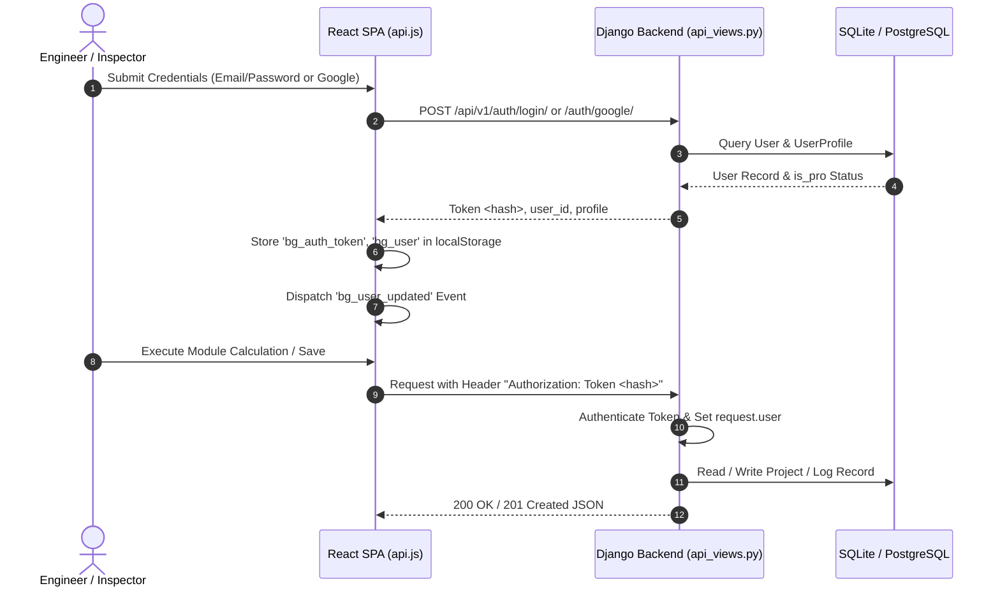
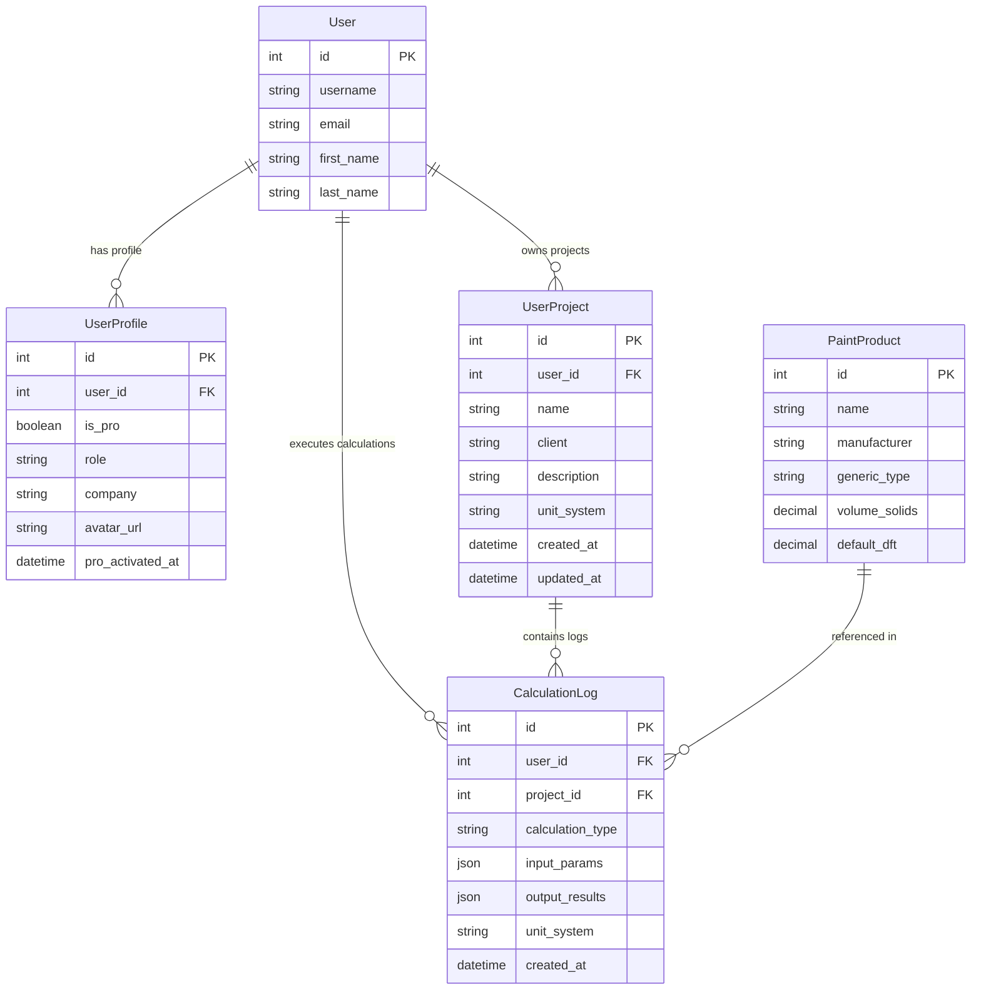
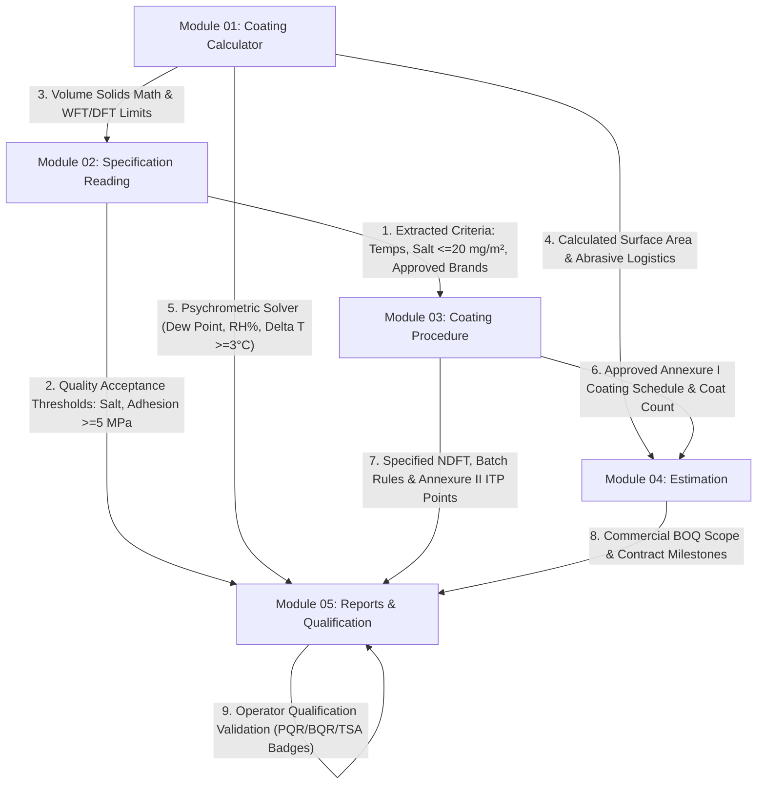
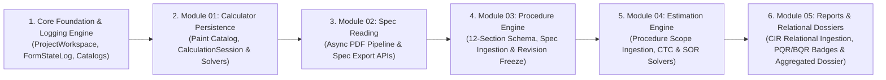

# CoatingOS — Project Architecture & Codebase Discovery Audit

> **Document Version:** 1.0.0  
> **Target System:** BG CoatingOS™ Enterprise Industrial Engineering Platform  
> **Audit Status:** VERIFIED & GROUNDED IN CODEBASE  
> **Author:** Antigravity AI Engineering Pair  
> **Date:** October 2026  

---

## 1. Executive Summary & Purpose

The objective of this architectural audit is to establish a rigorous, ground-truth technical foundation for transforming five core engineering modules of **BG CoatingOS™** from client-side prototype states into dynamic, database-backed, multi-tenant enterprise services powered by a Python/Django REST API backend.

The five target modules are:
1. **Coating Calculator** (36+ engineering calculators spanning paint volume, surface geometries, blasting media, ISO 8502 salt test, and Executive PRO suites)
2. **Specification Reading** (Automated & manual coating specification extraction, technical requirements matrix, operating temperature profiles, coating system design, and QC compliance)
3. **Coating Procedure** (Inspection and Test Plan [ITP] and Procedure Qualification Dossier builder across 12 structured engineering sections with annexures and revision control)
4. **Estimation** (Discrete Unit-Rate Estimation and Industrial Manpower Project Estimator with equipment CTC, abrasive/diesel logistics, and commercial summary)
5. **Reports** (Coating Inspection Reports [CIR], Spray Painter Qualification [PQR], Blaster Qualification [OQR], TSA Operator Qualification, and Executive Engineering Dossiers)

---

## 2. Technology Stack & Architectural Inventory

```
┌────────────────────────────────────────────────────────────────────────────────────────┐
│                                   CLIENT BROWSERS                                      │
└──────────────────────────────────────────┬─────────────────────────────────────────────┘
                                           │ HTTP/HTTPS (Port 3000 / 80 / 443)
┌──────────────────────────────────────────▼─────────────────────────────────────────────┐
│                          FRONTEND: React 18 SPA (Vite 5)                                │
│  • App Root: calculator-react/src/App.jsx                                              │
│  • Router: calculator-react/src/utils/router.js (HTML5 History API)                    │
│  • Styles: Tailwind CSS 3.4 + Custom Tokens (coatingos.css, coating-calculator.css)   │
│  • State: Local React State + Custom Event Bus + Web Storage (localStorage)           │
│  • API Client: calculator-react/src/utils/api.js (Fetch API + Token Auth)              │
└──────────────────────────────────────────┬─────────────────────────────────────────────┘
                                           │ REST JSON APIs (Port 8000 / /api/v1/)
┌──────────────────────────────────────────▼─────────────────────────────────────────────┐
│                          BACKEND: Django 6.1 + Django REST Framework                   │
│  • Root Config: backend/bgcoating_config/ (settings.py, urls.py, wsgi.py)              │
│  • Core App: backend/website/ (models.py, api_views.py, calculator_engine.py)          │
│  • Database: SQLite (backend/db.sqlite3) [Target: PostgreSQL in production]           │
│  • Auth: TokenAuthentication + Django Session + Google OAuth2 Token Verification       │
└──────────────────────────────────────────┬─────────────────────────────────────────────┘
                                           │ Internal Micro-Service / Shared DB
┌──────────────────────────────────────────▼─────────────────────────────────────────────┐
│                          ADMIN PANEL: NestJS 10 + Handlebars                           │
│  • Location: admin-panel/src/ & admin-panel/views/                                    │
│  • Role: CMS & Platform Admin for website content, blogs, standards, and testimonials  │
└────────────────────────────────────────────────────────────────────────────────────────┘
```

### 2.1 Frontend Framework & Build System
- **Framework:** React 18.2.0 (`calculator-react/package.json`)
- **Build Tool:** Vite 5.1.6 (`calculator-react/vite.config.js`)
- **Icons:** Lucide React 0.344.0 (`lucide-react`)
- **CSS Preprocessor / Framework:** Tailwind CSS 3.4.1 + Autoprefixer 10.4.18 + PostCSS 8.4.35
- **Design Tokens & Theme:**
  - `calculator-react/src/styles/coatingos.css` (4,660 lines of industrial enterprise primitives)
  - `calculator-react/src/styles/coating-calculator.css` (499 lines for calculator cards, inputs, and gauges)
  - `calculator-react/src/styles/specification-reading.css` (519 lines for spec reading form grids and frozen bars)
- **Deployment Artifacts:** Compiled via `npm run build` into `calculator-react/dist/` and synced to root `dist/`.

### 2.2 Routing & Navigation Architecture
- **Routing Engine:** Custom HTML5 History Router implemented in `calculator-react/src/utils/router.js`.
- **Navigation Dispatch:**
  - Route parsing: `parseCurrentUrl()` parses `window.location.pathname` into `{ page, subTool }`.
  - Reverse routing: `getUrlFor(page, subTool)` computes deterministic canonical URLs.
  - State Sync: `App.jsx` synchronizes browser history via `window.history.pushState` and `popstate` event listeners.
- **Top-Level Navigation Shell:**
  - `calculator-react/src/components/Sidebar.jsx`: 605 lines defining a dual-mode (Desktop Pinned + Mobile Slide-over Drawer) navigation rail.
  - `calculator-react/src/components/Header.jsx`: 1,020 lines featuring multi-modal sticky headers tailored to each engineering suite.

### 2.3 Backend Framework & Data Architecture
- **Framework:** Python 3.13 / 3.14 + Django (`backend/bgcoating_config/`, `backend/website/`).
- **REST Framework:** Django REST Framework (`djangorestframework`) using `DefaultRouter` registered under `/api/v1/` in `backend/website/urls.py`.
- **Database Engine:** SQLite (`backend/db.sqlite3`) for local runtime; schema defined via Django ORM migrations (`backend/website/migrations/`).
- **Calculation Engine:** Python calculation functions in `backend/website/calculator_engine.py` with API gateway in `backend/website/api_views.py::api_calculate`.
- **Authentication Engine:** DRF `TokenAuthentication` combined with `UserProfile` extended auth models.

### 2.4 Administrative Panel (NestJS)
- **Framework:** NestJS 10.0.0 (TypeScript) located in `admin-panel/`.
- **Template Engine:** Handlebars (`hbs`) in `admin-panel/views/`.
- **Purpose:** Content management for public website entities (services, categories, blogs, technical standards reference, inquiries, SEO metadata).

---

## 3. Directory & File Mapping

### 3.1 Frontend Codebase Hierarchy (`calculator-react/`)
```
calculator-react/
├── src/
│   ├── components/            # Shared UI Shell & Global Modals
│   │   ├── Header.jsx         # Sticky top navigation with multi-module modes
│   │   ├── Sidebar.jsx        # Pinned desktop and mobile slide-over drawer
│   │   ├── AuthModal.jsx      # Email/Google sign-in and registration modal
│   │   ├── ErrorBoundary.jsx  # React lifecycle crash boundary
│   │   ├── GuidelineDrawer.jsx# Slide-in AMPP/NACE/ISO technical guideline drawer
│   │   ├── HelpFaqDrawer.jsx  # Contextual engineering FAQ & help drawer
│   │   ├── MetricCard.jsx     # KPI presentation card primitive
│   │   ├── PlanUpgradeModal.jsx# Subscription tier & licensing modal
│   │   ├── ProReferenceCard.jsx# Standard engineering reference preview card
│   │   └── ToastContainer.jsx # Floating non-blocking toast notifications
│   ├── context/
│   │   ├── GuidelineContext.jsx # AMPP/ISO guideline drawer provider
│   │   └── ToastContext.jsx     # Global alert/notification context
│   ├── data/                  # Static/Seed Reference Databases (Mock / In-Memory)
│   │   ├── blasterDatabase.js    # Blaster qualification rubrics, standards, grading
│   │   ├── contractorDatabase.js # Contractor profiles, manpower, equipment assets
│   │   ├── guidelinesData.js     # ISO 12944, SSPC-PA 2, ISO 8501-1 engineering guidelines
│   │   ├── inspectionDatabase.js # CIR inspection test points, stages, acceptance criteria
│   │   ├── manpowerDatabase.js   # Equipment CTC, worker wages, blasting/painting rates
│   │   ├── painterDatabase.js    # Spray painter PQR grading, test stages, checklists
│   │   ├── procedureDatabase.js  # 12-section Coating Procedure templates & master systems
│   │   ├── specDatabase.js       # Specification extraction schemas & sample projects
│   │   ├── tsaDatabase.js        # Twin wire arc thermal spray aluminium qualification rules
│   │   └── unitRateDatabase.js   # Unit rate cost items, surface preparation rates
│   ├── pages/                 # Top-Level Module Viewport Containers
│   │   ├── DashboardPage.jsx            # Platform hub with organogram & quick links
│   │   ├── CoatingCalculatorPage.jsx    # Module 01: 36+ Engineering Calculator Tools
│   │   ├── SpecificationReadingPage.jsx # Module 02: Spec Reading & Extraction Engine
│   │   ├── CoatingProcedurePage.jsx     # Module 03: Coating Procedure (ITP) Platform
│   │   ├── UnitRateEstimationPage.jsx   # Module 04A: Quick Unit Rate Estimator
│   │   ├── ManpowerEstimationPage.jsx   # Module 04B: Manpower Project Estimator
│   │   ├── InspectionReportingPage.jsx  # Module 05A: Coating Inspection Reports (CIR)
│   │   ├── PainterQualificationPage.jsx # Module 05B: Spray Painter Qualification (PQR)
│   │   ├── BlasterQualificationPage.jsx # Module 05C: Blaster Qualification (OQR)
│   │   ├── TsaQualificationPage.jsx     # Module 05D: TSA Operator Qualification
│   │   ├── ContractorManagementPage.jsx # Contractor & manpower asset management
│   │   ├── KnowledgePage.jsx            # Engineering standards reference library
│   │   ├── SettingsPage.jsx             # User profile, company branding & defaults
│   │   ├── SupportPage.jsx              # Help desk & technical consultation
│   │   └── LoginPage.jsx                # Dedicated authentication screen
│   ├── tools/                 # Discrete Tool Implementations
│   │   ├── abrasives/         # Garnet & copper slag consumption tools
│   │   ├── blaster/           # Blaster OQR workflow sheets & photo reporting
│   │   ├── compliance/        # SSPC-PA 2 & ISO 19840 compliance tools
│   │   ├── contractor/        # Contractor sub-views & team rosters
│   │   ├── inspection/        # CIR stages, adhesion pull-off, cross-cut tools
│   │   ├── manpower/          # Project info, blasting, painting, raw material tools
│   │   ├── paint/             # WFT, DFT, volume solids, dead volume, coverage tools
│   │   ├── painter/           # Painter PQR workflow sheets, coat stages, checklists
│   │   ├── pro/               # 28 Executive PRO engineering calculators
│   │   ├── procedure/         # 12 Coating Procedure sections, register, print dossier
│   │   ├── salt/              # ISO 8502-9 Bresle conductivity & temperature tools
│   │   ├── spec/              # Spec reading tabs (Scope, Temp, Systems, QC, Mfrs)
│   │   ├── specialized/       # Dew point, psychrometric, pot life, recoat tools
│   │   ├── surface/           # Pipe, tank shell/roof, structural steel geometry tools
│   │   ├── tsa/               # TSA qualification workflow sheets & test catalog
│   │   └── unitrate/          # Unit rate sheets, cost matrix, summary, register
│   ├── utils/
│   │   ├── api.js             # HTTP client with token injection & auth endpoints
│   │   ├── calculationEngine.js # Client-side core formulas & math engine
│   │   ├── calculations.js    # Extended geometric & abrasive consumption functions
│   │   ├── router.js          # URL parser, canonical routes & reverse lookups
│   │   ├── standardsDatabase.js # Global technical standards lookup table
│   │   └── visitorTracker.js  # Zero-footprint telemetry & dwell time tracker
│   ├── App.jsx                # Root component coordinating state, shell & routing
│   └── main.jsx               # React DOM entry point
└── package.json
```

### 3.2 Backend Codebase Hierarchy (`backend/`)
```
backend/
├── bgcoating_config/
│   ├── settings.py            # Django configuration (INSTALLED_APPS, DATABASES, CORS)
│   ├── urls.py                # Root URL dispatcher routing /admin/ and website.urls
│   └── wsgi.py                # WSGI entry point for Gunicorn / Nginx
├── website/
│   ├── migrations/            # Database schema versions 0001 through 0013
│   ├── admin.py               # Django Admin model registrations
│   ├── api_views.py           # DRF ViewSets & custom function-based API endpoints
│   ├── apps.py                # Application config
│   ├── calculator_engine.py   # Python mathematical calculation engine
│   ├── models.py              # 19 ORM models (CMS, Auth, Calculations, Logs)
│   ├── serializers.py         # DRF ModelSerializers & validation logic
│   ├── urls.py                # DRF DefaultRouter & view bindings
│   └── views.py               # Django template-rendered legacy / public endpoints
├── db.sqlite3                 # Local relational database
└── requirements.txt           # Python dependency manifest
```

---

## 4. Route & Navigation Inventory

The platform is organized into discrete URL paths managed client-side by `calculator-react/src/utils/router.js` and rendered by `calculator-react/src/App.jsx`.

### 4.1 Master Page Routes
| Route URL | Internal Page Key | React Component | Sidebar Menu Position | Navigation Status |
| :--- | :--- | :--- | :--- | :--- |
| `/dashboard` | `dashboard` | `DashboardPage` | Item 1: Home | **VERIFIED** |
| `/coating-calculator/*` | `coating-calculator` | `CoatingCalculatorPage` | Item 2: Coating Calculator | **VERIFIED** |
| `/specification-reading/*` | `specification-reading` | `SpecificationReadingPage` | Item 3: Specification Reading | **VERIFIED** |
| `/coating-procedure/*` | `coating-procedure` | `CoatingProcedurePage` | Item 4: Coating Procedure | **VERIFIED** |
| `/unit-rate-estimation/*` | `unit-rate-estimation` | `UnitRateEstimationPage` | Item 5A: Estimation › Quick Unit-Rate | **VERIFIED** |
| `/manpower-estimation/*` | `manpower-estimation` | `ManpowerEstimationPage` | Item 5B: Estimation › Manpower Project | **VERIFIED** |
| `/inspection-reporting/*` | `inspection-reporting` | `InspectionReportingPage` | Item 6A: Documentation › Inspection (CIR) | **VERIFIED** |
| `/painter-qualification/*` | `painter-qualification` | `PainterQualificationPage` | Item 6B: Documentation › Painter (PQR) | **VERIFIED** |
| `/blaster-qualification/*` | `blaster-qualification` | `BlasterQualificationPage` | Item 6C: Documentation › Blaster (OQR) | **VERIFIED** |
| `/tsa-qualification/*` | `tsa-qualification` | `TsaQualificationPage` | Item 6D: Documentation › TSA Qualification | **VERIFIED** |
| `/contractor-management/*` | `contractor-management` | `ContractorManagementPage` | Item 7: Contractor Management | **VERIFIED** |
| `#` (Disabled) | `academy-lms` | `App.jsx (Disabled)` | Item 8: Training & Certification | **VERIFIED DISABLED** |
| `/knowledge` | `knowledge` | `KnowledgePage` | Item 10: Standards Library | **VERIFIED** |
| `/support` | `support` | `SupportPage` | Item 11: Technical Support | **VERIFIED** |
| `/settings` | `settings` | `SettingsPage` | Item 12: Profile & Settings | **VERIFIED** |
| `/login` | `login` | `LoginPage` | Auth Trigger | **VERIFIED** |

---

## 5. Shared Component Inventory

All modules consume an integrated set of shared shell primitives, modals, contexts, and presentation cards:

| Component Name | Source Path | Role & Responsibilities | Responsive Behavior |
| :--- | :--- | :--- | :--- |
| **Header** | `src/components/Header.jsx` | Sticky top bar (`top-0 z-30`). Adapts header layout across 8 specialized modes (Platform, Calculator, Spec, Procedure, Manpower, Blaster, Painter, Inspection). Provides zoom control, breadcrumbs, action buttons, and status pill. | On mobile, hides verbose titles/progress tracks, adds `overflow-x-auto no-scrollbar` to action strips. |
| **Sidebar** | `src/components/Sidebar.jsx` | Navigation spine. Renders fixed `264px` charcoal rail on desktop (`md:flex`) and slide-over overlay drawer with backdrop blur on mobile (`fixed inset-0 z-50`). | Desktop: pinned `h-screen`. Mobile: toggled via event bus `bg_toggle_sidebar`. |
| **AuthModal** | `src/components/AuthModal.jsx` | Modal dialog for Email/Password registration, sign-in, and Google OAuth2 login. | Centers in viewport with backdrop scrim; full-width on mobile. |
| **GuidelineDrawer** | `src/components/GuidelineDrawer.jsx` | Slide-over drawer displaying AMPP, ISO, SSPC standards and acceptance thresholds. Triggered by GuidelineContext. | Slides from right edge (`w-full max-w-lg`). |
| **HelpFaqDrawer** | `src/components/HelpFaqDrawer.jsx` | Contextual technical help with search bar and keyword filters for coating formulas. | Slides from right edge (`w-full max-w-md`). |
| **PlanUpgradeModal** | `src/components/PlanUpgradeModal.jsx` | Displays pricing tiers (Free, Standard, Pro, Enterprise) and upgrade workflows. | Responsive multi-column grid collapsing to single card on mobile. |
| **MetricCard** | `src/components/MetricCard.jsx` | Standard KPI statistic block with title, number, icon, subtitle, and delta badge. | Auto-fits via CSS grid `repeat(auto-fit, minmax(180px, 1fr))`. |
| **ProReferenceCard** | `src/components/ProReferenceCard.jsx` | Displays engineering equations, standard cross-references, and normative guidelines. | Collapsible on smaller viewports. |
| **ToastContainer** | `src/components/ToastContainer.jsx` | Non-blocking alert system for save, validation, copy, and error events. | Pinned to top-right (`fixed top-4 right-4 z-50`). |
| **ErrorBoundary** | `src/components/ErrorBoundary.jsx` | React component error trap preventing unhandled errors from breaking the SPA. | Renders clean alert with reset CTA. |

---

## 6. Frontend-to-Backend Data Flow

### 6.1 Authentication & Session Architecture


- **Token Storage:** `localStorage.getItem('bg_auth_token')`.
- **State Hydration:** On app boot, `App.jsx` reads `bg_auth_logged_in` and fetches fresh profile data via `fetchUserProfile()` in `calculator-react/src/utils/api.js`.
- **Header Injection:** All outbound fetch requests in `apiRequest()` automatically append `Authorization: Token <token>` unless calling auth endpoints.

### 6.2 Current API Endpoints Inventory (`backend/website/urls.py`)
| HTTP Method | URL Endpoint | Django Handler Function / ViewSet | Functionality |
| :--- | :--- | :--- | :--- |
| `POST` | `/api/v1/auth/register/` | `api_views.api_register` | User registration with default profile creation |
| `POST` | `/api/v1/auth/login/` | `api_views.api_login` | Authenticates user; returns DRF Token & profile |
| `POST` | `/api/v1/auth/google/` | `api_views.api_google_auth` | Verifies Google OAuth token; auto-provisions user |
| `GET/PATCH` | `/api/v1/auth/profile/` | `api_views.api_user_profile` | Reads/updates full name, company, role, settings |
| `POST/DEL` | `/api/v1/auth/profile/avatar/` | `api_views.api_user_avatar` | Uploads or removes user avatar image file |
| `POST` | `/api/v1/users/<id>/toggle-pro/` | `api_views.api_toggle_user_pro` | Admin endpoint toggling Pro subscription status |
| `DELETE` | `/api/v1/users/<id>/delete/` | `api_views.api_delete_user` | Admin endpoint for account de-provisioning |
| `POST` | `/api/v1/calculator/calculate/` | `api_views.api_calculate` | Executes tank shell, tank roof, pipe spool math & logs |
| `GET/POST` | `/api/v1/calculator/projects/` | `api_views.UserProjectViewSet` | CRUD operations on user calculation project workspaces |
| `GET` | `/api/v1/calculator/logs/` | `api_views.CalculationLogViewSet` | Reads calculation audit log records |
| `GET/POST` | `/api/v1/calculator/products/` | `api_views.PaintProductViewSet` | Reference catalog of paint products (VS%, generic type) |
| `POST` | `/api/v1/visitors/duration/` | `api_views.api_update_visitor_duration` | Telemetry updating page dwell time & session duration |

---

## 7. Current Database Models & Schema Capabilities

Inspection of `backend/website/models.py` reveals 19 existing models. Four models directly support the engineering tools:



### 7.1 Existing Engineering Models
1. **`UserProfile`** (`models.py:512`):
   - Extends `django.contrib.auth.models.User` with one-to-one mapping.
   - Fields: `is_pro` (Boolean), `role` (CharField), `company` (CharField), `phone` (CharField), `avatar` (ImageField), `avatar_url` (URLField), `auth_provider` (CharField: `email`, `google`), `pro_activated_at` (DateTimeField).
2. **`UserProject`** (`models.py:445`):
   - Represents an engineering project workspace owned by a registered user.
   - Fields: `user` (ForeignKey to User), `name` (CharField), `client` (CharField), `description` (TextField), `unit_system` (CharField: `metric` / `imperial`), `created_at`, `updated_at`.
3. **`CalculationLog`** (`models.py:463`):
   - Records an immutable snapshot of calculation inputs and computed results.
   - Fields: `user` (ForeignKey User, nullable), `project` (ForeignKey UserProject, nullable), `calculation_type` (CharField: `tank_shell`, `tank_roof`, `pipe_spool`, `structural_steel`), `input_params` (JSONField), `output_results` (JSONField), `unit_system` (CharField), `client_ip` (GenericIPAddressField), `user_agent` (TextField), `created_at`.
4. **`PaintProduct`** (`models.py:493`):
   - Catalog of coating materials.
   - Fields: `name`, `manufacturer`, `generic_type` (Zinc, Epoxy, Polyurethane), `volume_solids` (DecimalField), `default_dft` (DecimalField), `cost_per_liter` (DecimalField), `is_active` (BooleanField).

---

## 8. Hardcoded vs. Dynamic Functionality Matrix

| Module | Feature / Data Area | Current Implementation State | Storage / Source Location | Target Dynamic Architecture |
| :--- | :--- | :--- | :--- | :--- |
| **Platform** | User Authentication & Profile | **DYNAMIC** | Django `/api/v1/auth/` + SQLite DB | Maintain & add Organization / Multi-tenancy |
| **Calculator** | Paint Specs & Solvents | **HARDCODED** | `standardsDatabase.js`, `calculationEngine.js` | Master `CoatingProduct` & `GenericPolymer` DB tables |
| **Calculator** | Geometry & Volume Calculations | **CLIENT-SIDE** | `calculations.js`, `calculationEngine.js` | Hybrid: Instant Client Preview + Python Verification API |
| **Calculator** | Calculations History & Saved Runs | **LOCAL STORAGE** | `localStorage.getItem('bg_calc_history')` | Django `CalculationSession` & `SavedCalculation` models |
| **Spec Reading** | Extracted Sections & Parameters | **LOCAL STORAGE** | `bg_spec_reading_draft` (`localStorage`) | Django `SpecificationDossier` & `SpecRequirement` models |
| **Spec Reading** | Standards & Temperature Matrices | **HARDCODED** | `specDatabase.js` | Dynamic `StandardCatalog` & `SpecTempRule` tables |
| **Spec Reading** | Specification PDF Ingestion | **MOCK / SIMULATED**| Regex / sample presets in `SpecHub.jsx` | Celery worker + `PyMuPDF` / `pypdf` + LLM extraction pipeline |
| **Procedure** | 12-Section Procedure Content | **LOCAL STORAGE** | `bg_os_procedure_draft` (`localStorage`) | Relational `CoatingProcedure` + 12 Section child models |
| **Procedure** | System Master Presets (A-1, A-2) | **HARDCODED** | `procedureDatabase.js` (`PROC_PRESETS`) | Django `CoatingSystemCatalog` & `InstrumentCatalog` |
| **Procedure** | Dossier Register & Approvals | **LOCAL STORAGE** | `bg_os_procedure_records` (`localStorage`) | Django `ProcedureRegister` + Workflow Approval Engine |
| **Estimation** | Unit Rates & Production Constants | **HARDCODED** | `unitRateDatabase.js` | Dynamic `CommercialRateSchedule` per Contractor/Client |
| **Estimation** | Manpower CTC & Wage Structures | **HARDCODED** | `manpowerDatabase.js` | Relational `LaborCategory` & `WorkerCTCProfile` models |
| **Estimation** | Project Estimation Records | **LOCAL STORAGE** | `bg_manpower_records_v1` (`localStorage`) | Django `EstimationProject` & `CostBreakdownSnapshot` |
| **Reports** | Inspection Reports (CIR) | **LOCAL STORAGE** | `bg_cir_records_v1`, `bg_inspection_draft_v1` | Relational `InspectionReport` + `InspectionStageLog` |
| **Reports** | Qualification Records (PQR/OQR/TSA) | **LOCAL STORAGE** | `bg_painter_records_v1`, `bg_blaster_records_v1` | Django `OperatorQualificationRecord` models |
| **Reports** | Dossier PDF Generation | **CLIENT-SIDE CSS** | `@media print` CSS engine in DOM | Server-side `WeasyPrint` / headless Chromium PDF renderer |

---

## 9. Existing Authentication, Permissions & Security

1. **Client-Side Auth State:**
   - Auth status: `localStorage.getItem('bg_auth_logged_in') === 'true'`.
   - Token: `localStorage.getItem('bg_auth_token')`.
   - Cached profile: `localStorage.getItem('bg_user')` containing `{ id, name, email, is_pro, role, company, provider }`.
2. **Server-Side Auth State:**
   - Django REST Framework `TokenAuthentication` via `rest_framework.authtoken.models.Token`.
   - `api_views.py` checks `request.user.is_authenticated`.
3. **Role & Permission Tiers:**
   - **Free Plan:** Access to basic calculators, view-only sample specifications, local draft storage.
   - **Pro Plan (`is_pro=True`):** Access to Executive PRO calculation suite, unlocked PDF dossier printing, Custom Company Details modal, watermark removal.
   - **Superuser (`is_superuser=True`):** Access to Django admin (`/admin/`), user pro toggling (`/api/v1/users/<id>/toggle-pro/`), visitor analytics.
4. **Current Security Vulnerabilities:**
   - **Unauthenticated Data Loss:** All major procedure drafts, unit rates, manpower models, and inspection records live strictly in client `localStorage`. Clearing browser cache permanently destroys client engineering records.
   - **No Multi-User Isolation:** If multiple inspectors share a device or browser profile, draft keys (`bg_os_procedure_draft`, `bg_spec_reading_draft`) overwrite each other.
   - **Client-Side Pro Bypassing:** Pro feature toggles are enforced via UI condition checks (`isUserPro`); backend endpoints currently lack fine-grained permission classes (`IsProUser`) on calculation logs and exports.

---

## 10. Inter-Module Dependency & Relational Fetching Architecture

A critical finding of this audit is that the five engineering modules are designed as **autonomous industrial tools**, but they share logical and mathematical dependencies that must be formally modeled in Django:



### 10.1 Module Separation Boundaries & Relational Roles
- **Coating Procedure vs. Estimation:**
  - *Coating Procedure* specifies **how** coating must be executed according to standards (ISO 12944, ISO 8501, SSPC-PA 2): surface profile, safety, blast exclusions, coat sequence, repair plans, and inspection instruments. It **does not calculate manpower costs or commercial profit margins**.
  - *Estimation* calculates **commercial project economics**: worker CTC, blasting rate per square meter, paint liter consumption, diesel liters, abrasive tonnage, supervisor overheads, and profit markups.
  - **Audit Directive:** These two modules remain strictly separated in distinct Django apps (`website/procedure/` and `website/estimation/`).
- **Specification Reading vs. Coating Procedure:**
  - *Specification Reading* is an **inbound document analyzer** that parses client/owner project specs into structured parameters.
  - *Coating Procedure* is an **outbound contractor dossier generator** (the contractor's formal submittal to the asset owner).
- **Dynamic Relational Fetching in Reports:**
  - *Inspection Reports (CIR, PQR, BQR, TSA)* do not ask inspectors to re-type data already defined upstream. The backend dynamically fetches:
    1. Surface prep standard (Sa 2.5), abrasive type, and profile range from `CoatingProcedure`.
    2. Multi-coat systems, generic paint types, and specified NDFT from `CoatingProcedure` (Annexure I).
    3. Soluble salt limits ($\le 20\ \text{mg/m}^2$) and adhesion thresholds ($\ge 5.0\ \text{MPa}$) from `SpecificationDossier`.
    4. Hourly climatic validation ($\Delta T \ge 3^\circ\text{C}, \text{RH} \le 85\%$) from the psychrometric engine.

---

## 11. Dynamic Form Logging & Implementation Recommendations

### 11.1 Dynamic Form Logging Engine
All modules will write to a unified, immutable audit model (`FormStateLog`):
1. **Auto-Saved Drafts:** Form interactions are saved asynchronously (`action='DRAFT_AUTOSAVE'`), preventing data loss without polluting production revision branches.
2. **Execution Logging:** Every calculation run, OCR document extraction, and unit rate solve writes a permanent snapshot of inputs and outputs (`action='CALCULATE_RUN'`).
3. **Immutable Revision Snapshots:** When procedures or estimates advance revisions (`Rev 0` $\to$ `Rev 1`), a frozen JSON snapshot of all 12 sections is permanently preserved in `ProcedureRevisionHistory`.
4. **Traceability:** Captures user ID, display name, IP address, user-agent, dirty fields, and timestamps for ISO 9001 auditability.

### 11.2 Technical Risks
1. **Large Schema Surface Area:** With 12 procedure sections, 8 specification sections, 4 qualification workflows, and 36 calculator tools, creating monolithic models will cause severe schema bloat. Models are modularized using foreign keys, JSONField for variable parameters, and relational fetch mixins.
2. **Formula Divergence:** If calculation formulas are maintained separately in JavaScript and Python, discrepancies in rounding will lead to inconsistent figures. The Python backend exposes stateless solver endpoints (`/api/v1/calculator/solve-wft/`, `/solve-psychrometric/`, `/solve-worker-ctc/`) that serve as the authoritative standard.
3. **Draft Concurrency & Revisions:** EPC engineering procedures require strict revision tracking. A simple overwrite CRUD model is replaced with our revision-controlled snapshot architecture.
4. **File Storage & Parsing Latency:** Extracting complex 150-page EPC coating specifications via OCR/LLM cannot occur synchronously in a standard HTTP request without triggering 504 Gateway Timeouts. An asynchronous task queue (Celery + Redis) is mandatory for Specification Reading.

### 11.3 Recommended Implementation Order



1. **Step 1: Core Foundation & Dynamic Logging Engine** (`ProjectWorkspace`, `FormStateLog`, `PaintProductCatalog`, User RBAC).
2. **Step 2: Module 01 — Coating Calculator Dynamic API** (Calculation session persistence, psychrometric validation solver, execution history).
3. **Step 3: Module 02 — Specification Reading Ingestion & Storage** (Document upload models, asynchronous parsing pipeline, structured criteria storage, `export-to-procedure` API).
4. **Step 4: Module 03 — Coating Procedure Architecture** (12-section relational schema, specification ingestion action, revision bumping with frozen snapshots, `coating-schedule` export API).
5. **Step 5: Module 04 — Estimation Engine** (Procedure schedule ingestion, worker CTC calculation models, abrasive/diesel logistics engine, commercial quotation API).
6. **Step 6: Module 05 — Inspection & Relational Report Engine** (CIR multi-stage readings, automatic pre-filling from approved procedures, relational fetch actions, QR verification, and unified project dossier aggregation endpoint).
