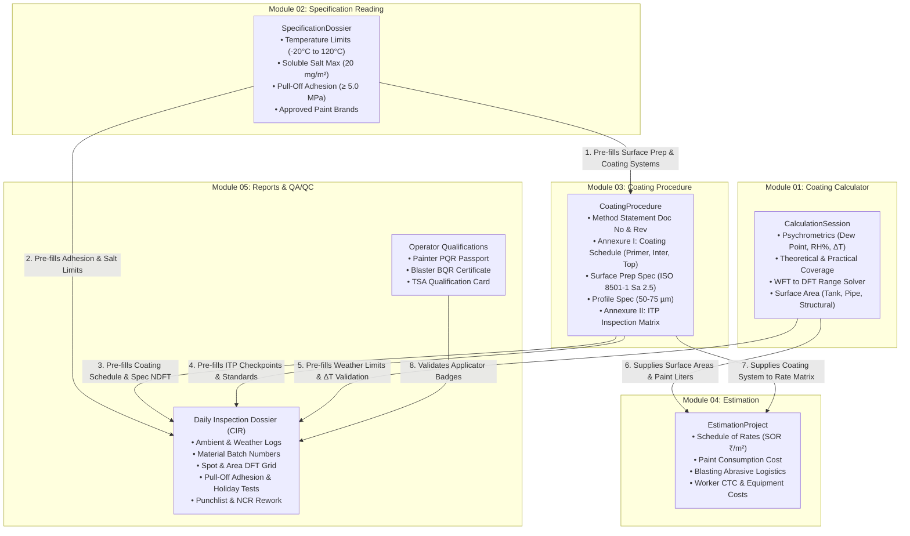

# CoatingOS — Phase 7: Cross-Module API Architecture & System Integration Blueprint

> **Document ID:** `DOC-MIG-06-CROSS-MODULE-API-ARCHITECTURE`  
> **Status:** AUDIT COMPLETED & IMPLEMENTATION BLUEPRINT (DYNAMIC FORMS, LOGGING & RELATIONAL REPORTS ENGINE)  
> **Scope:** Dynamic Form Logging Engine, Cross-Module Relational Fetch Engine, Unified Database Schema, Django Serializers, API ViewSets, Aggregated Project Dossier  
> **Parent Workspace:** `c:/Users/ADMIN/Documents/Workspace/bgcoating.com`

---

## 1. Executive Summary & Architectural Integrity

The preceding audits (Modules 00 through 05) conducted an exhaustive, file-by-file forensic inspection of the entire CoatingOS repository. They revealed five robust, mathematically mature engineering modules currently operating client-side in React 18:

1. **Coating Calculator:** 36+ tools covering Paint math, Surface Geometries, Media/Nozzle sizing, and Executive PRO engineering models.
2. **Specification Reading:** An 8-section technical specification ingestion, review, and approved vendor matrix suite.
3. **Coating Procedure:** A 12-section protective coating method statement, technical procedure, and Inspection & Test Plan (ITP) dossier generator.
4. **Estimation:** Two specialized commercial engines: Quick Unit-Rate bidding (SOR ₹/m²) and Comprehensive Manpower Project Costing (Worker CTC, Diesel logistics, Equipment, Overheads).
5. **Reports:** Regulatory and QA/QC credentialing engines: Daily Coating Inspection Reports (CIR), Painter PQR, Blaster BQR, and TSA Qualification passports.

To evolve CoatingOS from independent client-side calculators into an enterprise cloud operating system, this document establishes two core architectural pillars:
1. **Dynamic Form & Execution Logging Architecture:** Every calculation run, form draft, change event, and formal submission is persistently logged with user attribution, timestamp, IP address, and complete input/output snapshots.
2. **Cross-Module Relational Fetching Engine:** Reports, procedures, estimations, and dossiers do not exist in isolation; they dynamically query and aggregate data from related modules (e.g., an Inspection Report fetches coating specs from Coating Procedure, salt limits from Specification Reading, and dew-point psychrometrics from Coating Calculator).

---

## 2. Dynamic Form Logging Architecture (Universal Logging Engine)

### 2.1 The Logging Strategy
Industrial protective coating projects require strict QA/QC traceability (ISO 9001 / SSPC / NACE). Every user action must be auditable:
- **Draft Auto-Saving:** Periodically saves the user's in-progress form state without overwriting production records.
- **Execution Run Logging:** Every time a calculation, document extraction, rate analysis, or inspection evaluation is performed, an immutable execution log is recorded.
- **Revision History Snapshots:** When a procedure, estimate, or inspection report is signed off or revised (`Rev 0` $\to$ `Rev 1`), a complete frozen JSON snapshot is archived.
- **Audit Trails:** Tracks who modified what field, when, from which IP address, and under which project authorization.

### 2.2 Universal Base Models (`backend/website/models_common.py`)

```python
import uuid
from django.db import models
from django.contrib.auth.models import User
from django.utils import timezone

class ProjectWorkspace(models.Model):
    """Parent tenant container linking all 5 modules for a specific client contract."""
    id = models.UUIDField(primary_key=True, default=uuid.uuid4, editable=False)
    project_code = models.CharField(max_length=60, unique=True, db_index=True)
    project_title = models.CharField(max_length=255)
    client_name = models.CharField(max_length=200)
    contractor_name = models.CharField(max_length=200, default="BG Coating & Corrosion Engineering")
    facility_location = models.CharField(max_length=255, blank=True)
    created_by = models.ForeignKey(User, on_delete=models.PROTECT, related_name='created_projects')
    created_at = models.DateTimeField(auto_now_add=True)
    updated_at = models.DateTimeField(auto_now=True)

    class Meta:
        ordering = ['-created_at']

    def __str__(self):
        return f"{self.project_code} - {self.project_title}"


class FormStateLog(models.Model):
    """
    Universal immutable log for tracking all form interactions, calculation runs, 
    auto-saved drafts, and user state transitions across all 5 modules.
    """
    ACTION_CHOICES = [
        ('DRAFT_AUTOSAVE', 'Draft Auto-Saved'),
        ('MANUAL_SAVE', 'Draft Manually Saved'),
        ('CALCULATE_RUN', 'Calculation Executed'),
        ('FORM_VALIDATE', 'Form Validated'),
        ('REVISION_SUBMIT', 'Formal Revision Submitted'),
        ('STATUS_CHANGE', 'Status Changed'),
        ('APPROVAL_SIGNOFF', 'Authorized Sign-Off Completed'),
        ('EXPORT_PDF', 'PDF Dossier Exported'),
        ('RESTORE_SNAPSHOT', 'Reverted to Historical Snapshot'),
    ]

    MODULE_CHOICES = [
        ('CALCULATOR', 'Coating Calculator'),
        ('SPEC_READING', 'Specification Reading'),
        ('PROCEDURE', 'Coating Procedure'),
        ('ESTIMATION', 'Commercial Estimation'),
        ('REPORTS', 'Inspection & Credential Reports'),
    ]

    id = models.UUIDField(primary_key=True, default=uuid.uuid4, editable=False)
    project = models.ForeignKey(ProjectWorkspace, on_delete=models.CASCADE, related_name='form_logs', null=True, blank=True)
    module = models.CharField(max_length=30, choices=MODULE_CHOICES, db_index=True)
    entity_id = models.UUIDField(db_index=True, help_text="ID of the specific entity (Session, Spec, Proc, Estimate, Report)")
    entity_type = models.CharField(max_length=80, db_index=True, help_text="Model class name, e.g., CalculationSession, InspectionDossier")
    action = models.CharField(max_length=30, choices=ACTION_CHOICES, db_index=True)
    
    # State snapshots
    form_inputs = models.JSONField(help_text="Complete key-value dictionary of raw user inputs at log time")
    calculated_outputs = models.JSONField(default=dict, blank=True, help_text="Computed metrics, summary tables, or extraction results")
    dirty_fields = models.JSONField(default=list, blank=True, help_text="List of field names modified since previous save")
    
    # Audit attribution
    user = models.ForeignKey(User, on_delete=models.SET_NULL, null=True, blank=True)
    user_display = models.CharField(max_length=150, blank=True)
    ip_address = models.GenericIPAddressField(null=True, blank=True)
    user_agent = models.TextField(blank=True)
    timestamp = models.DateTimeField(default=timezone.now, db_index=True)

    class Meta:
        ordering = ['-timestamp']
        indexes = [
            models.Index(fields=['module', 'entity_id', '-timestamp']),
            models.Index(fields=['project', '-timestamp']),
        ]

    def __str__(self):
        return f"[{self.module}] {self.entity_type} {self.action} by {self.user_display} at {self.timestamp}"
```

---

## 3. Cross-Module Relational Fetching Engine

### 3.1 Relational Architecture & Information Flow

The five modules form a coherent pipeline. Reports are the ultimate synthesis of all preceding engineering activities:



### 3.2 Relational Fetching Matrix for Reports

When an inspector opens a **Daily Coating Inspection Report (CIR)** or generates a **Procedure Qualification Record (PQR)**, the backend dynamically fetches:

| Target Report Section | Data Source Module | Source Model & Fields Fetched | How It Is Used in Report |
| :--- | :--- | :--- | :--- |
| **Project Header & Details** | `ProjectWorkspace` | `project_title`, `client_name`, `contractor_name`, `facility_location` | Populates official report header and corporate metadata |
| **Surface Prep & Abrasive** | `CoatingProcedure` | `surface_prep_grade` (Sa 2.5), `abrasive_type` (Garnet 30/60), `profile_min_um`, `profile_max_um` | Automatically populates Section 1.0 Surface Prep verification table |
| **Acceptance Criteria & Limits** | `SpecificationDossier` | `max_salt_density_mg_m2` (≤ 20), `min_pull_off_adhesion_mpa` (≥ 5.0), `holiday_voltage_kv` | Sets the PASS/FAIL validation thresholds on physical field tests |
| **Climatic Envelope & ΔT Rules** | `CalculationSession` / Psychrometric Engine | Dew Point equation, steel temp $\Delta T \ge 3^\circ\text{C}$, maximum RH $\le 85\%$ | Validates hourly weather slots (09:00 - 17:00) against psychrometric envelope |
| **Multi-Coat System Schedule** | `CoatingProcedure` (Annexure I) | System ID, generic paint types, specified NDFT (75 µm / 150 µm / 50 µm), recoat intervals | Generates the multi-coat inspection rows and auto-fills specified NDFT |
| **Approved Paint Products** | `PaintProductCatalog` | Approved manufacturers (Jotun, Hempel), volume solids %, mix ratios | Restricts paint selection and auto-computes allowable WFT ranges |
| **Certified Applicators** | `OperatorQualification` | `certificate_number`, `candidate_name`, `qual_type`, `expiry_date`, active badge | Auto-validates that blasters/painters working on the shift hold valid credentials |
| **Inspection Matrix & ITP Points**| `CoatingProcedure` (Annexure II) | Checkpoints, testing instruments (Elcometer 456, Bresle patch), standards | Pre-populates the inspection activity checklist and sign-off table |

---

## 4. Comprehensive Django Database Models

The following models implement the dynamic form logging and cross-module relational fetching architecture.

```python
# backend/website/models_dynamic.py
import uuid
from django.db import models
from django.contrib.auth.models import User
from django.utils import timezone
from .models_common import ProjectWorkspace, FormStateLog

# ==============================================================================
# MODULE 01: COATING CALCULATOR MODELS
# ==============================================================================

class PaintProductCatalog(models.Model):
    """Master reference database for industrial paints and protective coatings."""
    id = models.UUIDField(primary_key=True, default=uuid.uuid4, editable=False)
    manufacturer = models.CharField(max_length=120, db_index=True)
    product_name = models.CharField(max_length=200, db_index=True)
    product_code = models.CharField(max_length=80, blank=True)
    generic_type = models.CharField(max_length=100) # Epoxy, Polyurethane, Inorganic Zinc
    volume_solids_pct = models.DecimalField(max_digits=5, decimal_places=2) # e.g. 80.00%
    density_g_per_ml = models.DecimalField(max_digits=5, decimal_places=2, null=True, blank=True)
    voc_g_per_l = models.DecimalField(max_digits=6, decimal_places=2, null=True, blank=True)
    recommended_min_dft_um = models.PositiveIntegerField()
    recommended_max_dft_um = models.PositiveIntegerField()
    mix_ratio_base = models.DecimalField(max_digits=5, decimal_places=2, default=1.0)
    mix_ratio_hardener = models.DecimalField(max_digits=5, decimal_places=2, default=0.0)
    thinner_code = models.CharField(max_length=50, blank=True)
    max_thinner_pct = models.DecimalField(max_digits=4, decimal_places=1, default=10.0)
    pot_life_hours_23c = models.DecimalField(max_digits=4, decimal_places=1, null=True, blank=True)
    is_active = models.BooleanField(default=True)
    created_at = models.DateTimeField(auto_now_add=True)

    class Meta:
        ordering = ['manufacturer', 'product_name']
        unique_together = ('manufacturer', 'product_name')


class CalculationSession(models.Model):
    """User-saved calculation sessions linked to projects and logged persistently."""
    id = models.UUIDField(primary_key=True, default=uuid.uuid4, editable=False)
    project = models.ForeignKey(ProjectWorkspace, on_delete=models.CASCADE, related_name='calculations', null=True, blank=True)
    user = models.ForeignKey(User, on_delete=models.CASCADE, related_name='calculator_sessions')
    tool_key = models.CharField(max_length=60, db_index=True)
    session_title = models.CharField(max_length=255)
    inputs = models.JSONField(help_text="Raw input parameters")
    results = models.JSONField(help_text="Calculated outputs, metrics, and compliance status")
    formula_version = models.CharField(max_length=20, default='1.0.0')
    notes = models.TextField(blank=True)
    created_at = models.DateTimeField(auto_now_add=True)
    updated_at = models.DateTimeField(auto_now=True)

    class Meta:
        ordering = ['-created_at']


# ==============================================================================
# MODULE 02: SPECIFICATION READING MODELS
# ==============================================================================

class SpecificationDossier(models.Model):
    """Technical specification record storing extracted requirements and client criteria."""
    id = models.UUIDField(primary_key=True, default=uuid.uuid4, editable=False)
    project = models.ForeignKey(ProjectWorkspace, on_delete=models.CASCADE, related_name='specifications')
    spec_document_name = models.CharField(max_length=255)
    spec_document_number = models.CharField(max_length=100, blank=True)
    uploaded_file = models.FileField(upload_to='specifications/%Y/%m/', null=True, blank=True)
    operating_temp_min_c = models.DecimalField(max_digits=5, decimal_places=1, default=-20.0)
    operating_temp_max_c = models.DecimalField(max_digits=5, decimal_places=1, default=120.0)
    max_soluble_salt_mg_m2 = models.DecimalField(max_digits=5, decimal_places=2, default=20.0)
    min_pull_off_adhesion_mpa = models.DecimalField(max_digits=4, decimal_places=1, default=5.0)
    holiday_test_voltage_v = models.PositiveIntegerField(null=True, blank=True)
    surface_prep_standard = models.CharField(max_length=80, default="ISO 8501-1 Sa 2.5")
    surface_profile_min_um = models.PositiveIntegerField(default=50)
    surface_profile_max_um = models.PositiveIntegerField(default=75)
    approved_manufacturers = models.JSONField(default=list, help_text="List of approved coating brands")
    extracted_clauses = models.JSONField(default=dict, help_text="AI/Regex parsed specification clauses")
    status = models.CharField(max_length=30, default='DRAFT') # DRAFT, REVIEWED, APPROVED
    created_by = models.ForeignKey(User, on_delete=models.PROTECT)
    created_at = models.DateTimeField(auto_now_add=True)
    updated_at = models.DateTimeField(auto_now=True)


# ==============================================================================
# MODULE 03: COATING PROCEDURE MODELS
# ==============================================================================

class CoatingProcedure(models.Model):
    """Technical Method Statement, Painting Procedure, and ITP Quality Matrix."""
    id = models.UUIDField(primary_key=True, default=uuid.uuid4, editable=False)
    project = models.ForeignKey(ProjectWorkspace, on_delete=models.CASCADE, related_name='procedures')
    linked_specification = models.ForeignKey(SpecificationDossier, on_delete=models.SET_NULL, null=True, blank=True, related_name='procedures')
    doc_number = models.CharField(max_length=100, unique=True, db_index=True)
    doc_title = models.CharField(max_length=255, default="Painting Procedure & Coating Specification")
    revision_number = models.CharField(max_length=20, default="0")
    purpose_scope = models.TextField()
    substrates_in_scope = models.CharField(max_length=255, default="Carbon Steel Piping, Pressure Vessels, Structural Steel")
    
    # Technical parameters (can be auto-populated from SpecificationDossier)
    surface_prep_grade = models.CharField(max_length=80, default="ISO 8501-1 Sa 2½ (Near-White Metal)")
    abrasive_type = models.CharField(max_length=100, default="Garnet 30/60 Mesh")
    profile_min_um = models.PositiveIntegerField(default=50)
    profile_max_um = models.PositiveIntegerField(default=75)
    max_soluble_salt_mg_m2 = models.DecimalField(max_digits=5, decimal_places=2, default=20.0)
    holding_time_hours = models.PositiveIntegerField(default=4)
    
    # Environmental envelope
    ambient_temp_min_c = models.DecimalField(max_digits=4, decimal_places=1, default=10.0)
    ambient_temp_max_c = models.DecimalField(max_digits=4, decimal_places=1, default=45.0)
    max_relative_humidity_pct = models.DecimalField(max_digits=4, decimal_places=1, default=85.0)
    min_dew_point_delta_c = models.DecimalField(max_digits=3, decimal_places=1, default=3.0)
    
    # Authorizations
    prepared_by = models.CharField(max_length=150, blank=True)
    reviewed_by = models.CharField(max_length=150, blank=True)
    approved_by = models.CharField(max_length=150, blank=True)
    status = models.CharField(max_length=30, default='DRAFT') # DRAFT, UNDER_REVIEW, APPROVED
    created_at = models.DateTimeField(auto_now_add=True)
    updated_at = models.DateTimeField(auto_now=True)


class ProcedureCoatingSystem(models.Model):
    """Annexure-I Coating Systems specified in the procedure."""
    procedure = models.ForeignKey(CoatingProcedure, on_delete=models.CASCADE, related_name='coating_systems')
    system_id = models.CharField(max_length=60) # e.g., 'SYSTEM-1A'
    service_description = models.CharField(max_length=255) # Atmospheric Exposure C5-M
    substrate = models.CharField(max_length=150, default="Carbon Steel")
    operating_temp_range = models.CharField(max_length=100, default="-20°C to +120°C")
    surface_prep = models.CharField(max_length=150, default="Garnet Blast Sa 2.5, Rz 50-75 µm")
    total_dft_nominal_um = models.PositiveIntegerField()


class ProcedureCoatingCoat(models.Model):
    """Individual coat breakdown for a procedure coating system."""
    coating_system = models.ForeignKey(ProcedureCoatingSystem, on_delete=models.CASCADE, related_name='coats')
    coat_order = models.PositiveSmallIntegerField(help_text="1 = Primer, 2 = Intermediate, 3 = Topcoat")
    coat_name = models.CharField(max_length=80) # Primer, 1st Intermediate, Topcoat
    generic_paint_type = models.CharField(max_length=120) # Zinc Ethyl Silicate, Epoxy MIO, Polyurethane
    dft_min_um = models.PositiveIntegerField()
    dft_nominal_um = models.PositiveIntegerField()
    dft_max_um = models.PositiveIntegerField()
    thinner_code = models.CharField(max_length=80, blank=True)
    min_recoat_hours = models.CharField(max_length=80, default="16 Hours @ 23°C")


# ==============================================================================
# MODULE 04: ESTIMATION MODELS
# ==============================================================================

class EstimationProject(models.Model):
    """Commercial cost model linking project scope, labor, equipment, and paint rates."""
    id = models.UUIDField(primary_key=True, default=uuid.uuid4, editable=False)
    project = models.ForeignKey(ProjectWorkspace, on_delete=models.CASCADE, related_name='estimations')
    linked_procedure = models.ForeignKey(CoatingProcedure, on_delete=models.SET_NULL, null=True, blank=True, related_name='estimations')
    estimation_title = models.CharField(max_length=255)
    total_surface_area_m2 = models.DecimalField(max_digits=12, decimal_places=2, default=0.0)
    total_project_cost_inr = models.DecimalField(max_digits=14, decimal_places=2, default=0.0)
    profit_margin_pct = models.DecimalField(max_digits=5, decimal_places=2, default=15.0)
    status = models.CharField(max_length=30, default='DRAFT')
    created_at = models.DateTimeField(auto_now_add=True)
    updated_at = models.DateTimeField(auto_now=True)


# ==============================================================================
# MODULE 05: REPORTS & QA/QC CREDENTIAL MODELS
# ==============================================================================

class OperatorQualification(models.Model):
    """Certified operator records for Painters (PQR), Blasters (BQR) & TSA."""
    QUAL_TYPES = [
        ('PAINTER', 'Painter Qualification Record (PQR)'),
        ('BLASTER', 'Blaster Qualification Record (BQR)'),
        ('TSA', 'Thermal Spray Aluminium Operator'),
    ]
    id = models.UUIDField(primary_key=True, default=uuid.uuid4, editable=False)
    certificate_number = models.CharField(max_length=100, unique=True, db_index=True)
    qual_type = models.CharField(max_length=20, choices=QUAL_TYPES, db_index=True)
    candidate_name = models.CharField(max_length=200)
    national_id = models.CharField(max_length=80, blank=True)
    candidate_photo = models.ImageField(upload_to='operators/photos/%Y/', null=True, blank=True)
    employer_company = models.CharField(max_length=200)
    theory_score_pct = models.PositiveIntegerField()
    practical_verdict = models.CharField(max_length=20, default='QUALIFIED')
    evaluated_by = models.CharField(max_length=150)
    qualification_date = models.DateField()
    expiry_date = models.DateField()
    is_active = models.BooleanField(default=True)

    class Meta:
        ordering = ['candidate_name']


class InspectionDossier(models.Model):
    """
    Daily Coating Inspection Report (CIR).
    Dynamically linked to Project, CoatingProcedure, and SpecificationDossier.
    """
    STATUS_CHOICES = [
        ('DRAFT', 'In-Progress Draft'),
        ('SUBMITTED', 'Submitted for Review'),
        ('APPROVED', 'Approved by TPI / Client'),
        ('REJECTED', 'Rejected / Rework Issued'),
    ]

    id = models.UUIDField(primary_key=True, default=uuid.uuid4, editable=False)
    project = models.ForeignKey(ProjectWorkspace, on_delete=models.CASCADE, related_name='inspection_reports')
    linked_procedure = models.ForeignKey(CoatingProcedure, on_delete=models.PROTECT, related_name='inspection_reports',
                                         help_text="Coating Procedure providing the technical baseline")
    linked_specification = models.ForeignKey(SpecificationDossier, on_delete=models.SET_NULL, null=True, blank=True,
                                             help_text="Specification providing acceptance criteria")
    
    # Official Report Metadata
    report_number = models.CharField(max_length=100, unique=True, db_index=True) # CIR-2026-0841
    inspection_date = models.DateField(default=timezone.now)
    item_component_description = models.CharField(max_length=255) # Tank Shell Course #1 - #4
    work_location = models.CharField(max_length=255) # Site Yard Sector-4
    structure_type = models.CharField(max_length=100, default="Storage Tank")
    
    # Psychrometric & Surface Prep Readings (Captured on site)
    weather_slots = models.JSONField(default=list, help_text="Hourly dry/wet/metal temp, RH, dew point logs")
    abrasive_batch = models.CharField(max_length=100, blank=True)
    nozzle_pressure_psi = models.PositiveIntegerField(default=100)
    measured_profile_rz_um = models.DecimalField(max_digits=5, decimal_places=1, default=65.0)
    measured_salt_density_mg_m2 = models.DecimalField(max_digits=5, decimal_places=2, default=12.0)
    cleanliness_visual_verdict = models.CharField(max_length=30, default="Sa 2.5 PASS")

    # Physical Quality Tests
    pull_off_adhesion_results = models.JSONField(default=dict, help_text="Dollies, MPa, and failure modes")
    cross_cut_adhesion_rating = models.CharField(max_length=10, blank=True) # 0B - 5B
    holiday_detector_voltage_v = models.PositiveIntegerField(null=True, blank=True)
    holiday_defect_count = models.PositiveIntegerField(default=0)

    # Multi-Party Signatures
    contractor_qc_name = models.CharField(max_length=150, blank=True)
    contractor_qc_signed_at = models.DateTimeField(null=True, blank=True)
    tpi_inspector_name = models.CharField(max_length=150, blank=True)
    tpi_signed_at = models.DateTimeField(null=True, blank=True)
    client_rep_name = models.CharField(max_length=150, blank=True)
    client_signed_at = models.DateTimeField(null=True, blank=True)

    status = models.CharField(max_length=20, choices=STATUS_CHOICES, default='DRAFT', db_index=True)
    created_by = models.ForeignKey(User, on_delete=models.PROTECT)
    created_at = models.DateTimeField(auto_now_add=True)
    updated_at = models.DateTimeField(auto_now=True)

    class Meta:
        ordering = ['-inspection_date', '-created_at']


class InspectionStageReading(models.Model):
    """Multi-coat paint application stage readings (Primer, Intermediate, Topcoat)."""
    dossier = models.ForeignKey(InspectionDossier, on_delete=models.CASCADE, related_name='coat_stages')
    stage_key = models.CharField(max_length=20) # s1, s2, s3
    coat_name = models.CharField(max_length=80) # Primer, 1st Intermediate, Topcoat
    manufacturer = models.CharField(max_length=120)
    product_name = models.CharField(max_length=150)
    shade_ral = models.CharField(max_length=80, blank=True)
    batch_a = models.CharField(max_length=100)
    batch_b = models.CharField(max_length=100, blank=True)
    specified_ndft_um = models.PositiveIntegerField() # Fetched from linked CoatingProcedure
    measured_wft_min_um = models.PositiveIntegerField(null=True, blank=True)
    measured_wft_max_um = models.PositiveIntegerField(null=True, blank=True)
    measured_dft_spot_values = models.JSONField(default=list, help_text="List of 5 spot readings per SSPC-PA 2")
    measured_dft_mean_um = models.DecimalField(max_digits=6, decimal_places=1)
    conformance_verdict = models.CharField(max_length=20, default='PASS') # PASS / FAIL
```

---

## 5. DRF Serializers for Dynamic Logging & Relational Fetching

### 5.1 Dynamic Form State & Audit Serializer

```python
# backend/website/serializers_common.py
from rest_framework import serializers
from .models_common import ProjectWorkspace, FormStateLog

class FormStateLogSerializer(serializers.ModelSerializer):
    """Serializes execution runs, drafts, and form audit records."""
    user_display = serializers.SerializerMethodField()

    class Meta:
        model = FormStateLog
        fields = [
            'id', 'project', 'module', 'entity_id', 'entity_type', 
            'action', 'form_inputs', 'calculated_outputs', 'dirty_fields',
            'user', 'user_display', 'ip_address', 'timestamp'
        ]
        read_only_fields = ['id', 'user', 'user_display', 'ip_address', 'timestamp']

    def get_user_display(self, obj):
        if obj.user:
            return obj.user.get_full_name() or obj.user.username
        return obj.user_display or 'System'
```

### 5.2 Dynamic Relational Fetching Serializer for Reports

When the frontend loads an inspection report, this serializer dynamically resolves and bundles related specification standards, procedure coating schedules, and psychrometric envelopes into a unified JSON response:

```python
# backend/website/serializers_reports.py
from rest_framework import serializers
from .models_dynamic import (
    InspectionDossier, 
    InspectionStageReading, 
    CoatingProcedure, 
    ProcedureCoatingSystem, 
    SpecificationDossier, 
    OperatorQualification
)

class LinkedCoatingScheduleSerializer(serializers.ModelSerializer):
    """Serializes approved procedure coats so the report form can auto-populate stages."""
    coats = serializers.SerializerMethodField()

    class Meta:
        model = ProcedureCoatingSystem
        fields = ['system_id', 'service_description', 'substrate', 'operating_temp_range', 'surface_prep', 'total_dft_nominal_um', 'coats']

    def get_coats(self, obj):
        return [
            {
                'coat_order': c.coat_order,
                'coat_name': c.coat_name,
                'generic_paint_type': c.generic_paint_type,
                'dft_min_um': c.dft_min_um,
                'dft_nominal_um': c.dft_nominal_um,
                'dft_max_um': c.dft_max_um,
                'thinner_code': c.thinner_code,
                'min_recoat_hours': c.min_recoat_hours,
            }
            for c in obj.coats.all().order_by('coat_order')
        ]


class LinkedProcedureSummarySerializer(serializers.ModelSerializer):
    """Provides procedure technical specifications required to validate the report."""
    coating_systems = LinkedCoatingScheduleSerializer(many=True, read_only=True)

    class Meta:
        model = CoatingProcedure
        fields = [
            'id', 'doc_number', 'doc_title', 'revision_number',
            'surface_prep_grade', 'abrasive_type', 'profile_min_um', 'profile_max_um',
            'max_soluble_salt_mg_m2', 'holding_time_hours',
            'ambient_temp_min_c', 'ambient_temp_max_c', 'max_relative_humidity_pct', 'min_dew_point_delta_c',
            'coating_systems'
        ]


class LinkedSpecificationCriteriaSerializer(serializers.ModelSerializer):
    """Provides specification limits to evaluate physical quality test thresholds."""
    class Meta:
        model = SpecificationDossier
        fields = [
            'id', 'spec_document_name', 'spec_document_number',
            'operating_temp_min_c', 'operating_temp_max_c',
            'max_soluble_salt_mg_m2', 'min_pull_off_adhesion_mpa',
            'holiday_test_voltage_v', 'approved_manufacturers'
        ]


class InspectionStageReadingSerializer(serializers.ModelSerializer):
    class Meta:
        model = InspectionStageReading
        fields = '__all__'
        read_only_fields = ['id', 'dossier']


class InspectionDossierDetailSerializer(serializers.ModelSerializer):
    """
    Master Serializer for Daily Coating Inspection Reports.
    Dynamically fetches and nests linked Procedure, Specification, and Stage readings.
    """
    coat_stages = InspectionStageReadingSerializer(many=True, required=False)
    related_procedure_details = serializers.SerializerMethodField()
    related_specification_criteria = serializers.SerializerMethodField()
    project_title = serializers.CharField(source='project.project_title', read_only=True)
    client_name = serializers.CharField(source='project.client_name', read_only=True)
    contractor_name = serializers.CharField(source='project.contractor_name', read_only=True)

    class Meta:
        model = InspectionDossier
        fields = [
            'id', 'project', 'project_title', 'client_name', 'contractor_name',
            'linked_procedure', 'related_procedure_details',
            'linked_specification', 'related_specification_criteria',
            'report_number', 'inspection_date', 'item_component_description',
            'work_location', 'structure_type', 'weather_slots',
            'abrasive_batch', 'nozzle_pressure_psi', 'measured_profile_rz_um',
            'measured_salt_density_mg_m2', 'cleanliness_visual_verdict',
            'coat_stages', 'pull_off_adhesion_results', 'cross_cut_adhesion_rating',
            'holiday_detector_voltage_v', 'holiday_defect_count',
            'contractor_qc_name', 'contractor_qc_signed_at',
            'tpi_inspector_name', 'tpi_signed_at',
            'client_rep_name', 'client_signed_at',
            'status', 'created_at', 'updated_at'
        ]
        read_only_fields = ['id', 'created_at', 'updated_at']

    def get_related_procedure_details(self, obj):
        if obj.linked_procedure:
            return LinkedProcedureSummarySerializer(obj.linked_procedure).data
        return None

    def get_related_specification_criteria(self, obj):
        if obj.linked_specification:
            return LinkedSpecificationCriteriaSerializer(obj.linked_specification).data
        return None
```

---

## 6. Django REST ViewSets with Dynamic Logging & Fetch Actions

```python
# backend/website/views_reports.py
from rest_framework import viewsets, status
from rest_framework.decorators import action
from rest_framework.response import Response
from rest_framework.permissions import IsAuthenticated
from django.utils import timezone
from .models_dynamic import InspectionDossier, InspectionStageReading, CoatingProcedure, SpecificationDossier
from .models_common import FormStateLog
from .serializers_reports import InspectionDossierDetailSerializer, LinkedProcedureSummarySerializer
from .serializers_common import FormStateLogSerializer

class InspectionDossierViewSet(viewsets.ModelViewSet):
    """
    ViewSet for Daily Inspection Reports (CIR).
    Supports dynamic logging, auto-filling from procedures, and relational fetching.
    """
    queryset = InspectionDossier.objects.all().select_related(
        'project', 'linked_procedure', 'linked_specification'
    ).prefetch_related('coat_stages')
    serializer_class = InspectionDossierDetailSerializer
    permission_classes = [IsAuthenticated]

    def perform_create(self, serializer):
        dossier = serializer.save(created_by=self.request.user)
        # Log initial creation
        self._log_action(dossier, 'MANUAL_SAVE', "Initial report draft created")

    def perform_update(self, serializer):
        dossier = serializer.save()
        # Log update
        self._log_action(dossier, 'MANUAL_SAVE', "Report draft updated")

    def _log_action(self, dossier, action_type, notes=""):
        """Internal helper to capture form state into FormStateLog."""
        ip = self.request.META.get('REMOTE_ADDR')
        user_agent = self.request.META.get('HTTP_USER_AGENT', '')
        FormStateLog.objects.create(
            project=dossier.project,
            module='REPORTS',
            entity_id=dossier.id,
            entity_type='InspectionDossier',
            action=action_type,
            form_inputs=self.request.data,
            calculated_outputs={'status': dossier.status, 'notes': notes},
            user=self.request.user,
            user_display=self.request.user.get_full_name() or self.request.user.username,
            ip_address=ip,
            user_agent=user_agent
        )

    @action(detail=True, methods=['get'], url_path='fetch-related')
    def fetch_related(self, request, pk=None):
        """
        Explicitly fetches and refreshes all related Procedure, Specification, 
        and Environmental limits for an active inspection report.
        """
        dossier = self.get_object()
        procedure_data = None
        spec_data = None

        if dossier.linked_procedure:
            procedure_data = LinkedProcedureSummarySerializer(dossier.linked_procedure).data
        if dossier.linked_specification:
            spec_data = {
                'max_salt_density_mg_m2': dossier.linked_specification.max_soluble_salt_mg_m2,
                'min_pull_off_adhesion_mpa': dossier.linked_specification.min_pull_off_adhesion_mpa,
                'holiday_test_voltage_v': dossier.linked_specification.holiday_test_voltage_v,
                'approved_manufacturers': dossier.linked_specification.approved_manufacturers,
            }

        return Response({
            'dossier_id': dossier.id,
            'report_number': dossier.report_number,
            'procedure': procedure_data,
            'specification': spec_data
        })

    @action(detail=False, methods=['post'], url_path='autofill-from-procedure')
    def autofill_from_procedure(self, request):
        """
        Pre-populates a new inspection report draft using parameters 
        from an approved CoatingProcedure ID.
        """
        procedure_id = request.data.get('procedure_id')
        if not procedure_id:
            return Response({'error': 'procedure_id is required'}, status=status.HTTP_400_BAD_REQUEST)

        try:
            procedure = CoatingProcedure.objects.get(id=procedure_id)
        except CoatingProcedure.DoesNotExist:
            return Response({'error': 'Procedure not found'}, status=status.HTTP_404_NOT_FOUND)

        # Build initial pre-filled report payload
        initial_stages = []
        systems = procedure.coating_systems.all()
        if systems.exists():
            first_sys = systems.first()
            for coat in first_sys.coats.all().order_by('coat_order'):
                stage_key = f"s{coat.coat_order}"
                initial_stages.append({
                    'stage_key': stage_key,
                    'coat_name': coat.coat_name,
                    'manufacturer': '',
                    'product_name': coat.generic_paint_type,
                    'specified_ndft_um': coat.dft_nominal_um,
                    'measured_dft_spot_values': [],
                    'measured_dft_mean_um': 0.0,
                    'conformance_verdict': 'PENDING'
                })

        prefilled_data = {
            'project_id': str(procedure.project.id),
            'linked_procedure_id': str(procedure.id),
            'linked_specification_id': str(procedure.linked_specification.id) if procedure.linked_specification else None,
            'abrasive_type': procedure.abrasive_type,
            'specified_surface_prep': procedure.surface_prep_grade,
            'specified_profile_min': procedure.profile_min_um,
            'specified_profile_max': procedure.profile_max_um,
            'max_allowable_salt': procedure.max_soluble_salt_mg_m2,
            'initial_stages': initial_stages,
        }
        return Response(prefilled_data, status=status.HTTP_200_OK)

    @action(detail=True, methods=['get'], url_path='history')
    def history(self, request, pk=None):
        """Retrieves the complete immutable audit trail of changes for this report."""
        dossier = self.get_object()
        logs = FormStateLog.objects.filter(
            module='REPORTS',
            entity_id=dossier.id
        ).order_by('-timestamp')
        serializer = FormStateLogSerializer(logs, many=True)
        return Response(serializer.data)
```

---

## 7. Unified Project Dossier Aggregation Endpoint

To compile a complete, auditable engineering package (combining Specifications, Procedures, Calculations, Estimations, and Inspection Logs into a single submittal), the API exposes a master aggregation endpoint:

```
GET /api/v1/projects/{project_id}/aggregate-dossier/
```

### Response Schema:
```json
{
  "project_summary": {
    "project_code": "PRJ-2026-LNG",
    "project_title": "Storage Tank External Coating Protection",
    "client_name": "Adani Total LNG / IOCL",
    "contractor": "BG Coating & Corrosion Engineering"
  },
  "specification": {
    "spec_number": "SPEC-LNG-C5M-001",
    "operating_temp_range": "-20°C to +120°C",
    "max_salt_limit_mg_m2": 20.0,
    "min_pull_off_adhesion_mpa": 5.0,
    "approved_manufacturers": ["Jotun", "Hempel", "AkzoNobel"]
  },
  "procedure": {
    "doc_number": "DOC-PROC-001",
    "revision": "Rev 0",
    "surface_prep": "ISO 8501-1 Sa 2.5",
    "coating_schedule": [
      { "coat": "Primer", "generic": "Zinc Ethyl Silicate", "nominal_dft_um": 75 },
      { "coat": "Intermediate", "generic": "Epoxy MIO", "nominal_dft_um": 150 },
      { "coat": "Topcoat", "generic": "Aliphatic Polyurethane", "nominal_dft_um": 50 }
    ],
    "total_nominal_dft_um": 275
  },
  "calculations": {
    "total_surface_area_m2": 4820.5,
    "theoretical_paint_liters": 1650.0,
    "practical_paint_liters_with_loss": 2145.0,
    "abrasive_garnet_tonnes": 85.0
  },
  "commercial_estimation": {
    "unit_rate_per_m2_inr": 850.0,
    "total_contract_value_inr": 4097425.0,
    "status": "APPROVED"
  },
  "inspection_reports": [
    {
      "report_number": "CIR-2026-0841",
      "date": "2026-08-29",
      "measured_profile_um": 64.5,
      "measured_salt_mg_m2": 11.8,
      "measured_mean_total_dft_um": 284.0,
      "adhesion_mean_mpa": 6.8,
      "verdict": "COMPLIANT_APPROVED"
    }
  ]
}
```

---

## 8. Summary of API Endpoints

| Module | Method | Endpoint URL | Purpose |
| :--- | :--- | :--- | :--- |
| **All** | `GET` | `/api/v1/projects/{project_id}/aggregate-dossier/` | Unified cross-module submittal dossier |
| **Common** | `GET` | `/api/v1/logs/?module={module}&entity_id={id}` | Fetches immutable form state change log |
| **Calculator** | `POST` | `/api/v1/calculator/sessions/save/` | Persists calculation run and logs inputs/outputs |
| **Calculator** | `GET` | `/api/v1/calculator/sessions/{id}/history/` | Retrieves past runs for a specific calculation |
| **Spec Reading**| `GET` | `/api/v1/specifications/{id}/export-to-procedure/` | Exports extracted limits to Procedure module |
| **Procedure** | `GET` | `/api/v1/procedure/{id}/fetch-spec/` | Fetches extracted criteria from linked Spec |
| **Procedure** | `POST` | `/api/v1/procedure/{id}/revision-bump/` | Freezes current snapshot, creates `Rev 1` draft |
| **Estimation** | `GET` | `/api/v1/estimation/{id}/fetch-scope/` | Fetches m² areas from Calc and coats from Proc |
| **Reports** | `POST` | `/api/v1/reports/cir/autofill-from-procedure/` | Pre-fills inspection stages from approved Procedure |
| **Reports** | `GET` | `/api/v1/reports/cir/{id}/fetch-related/` | Relational fetch of linked Spec, Proc, & Limits |
| **Reports** | `GET` | `/api/v1/reports/cir/{id}/history/` | Audit log of CIR edits, tests, and signatures |

---

## 9. Conclusion & Implementation Readiness

With this architecture:
1. **Forms are fully dynamic:** Every state change, draft save, calculation execution, and formal sign-off writes to `FormStateLog`.
2. **Reports are relationally integrated:** The QA/QC inspector never re-keys data that was already extracted in Specification Reading or defined in Coating Procedure.
3. **Traceability is total:** Engineering submittals, client audits, and field inspections link back to a single source of truth under a `ProjectWorkspace`.